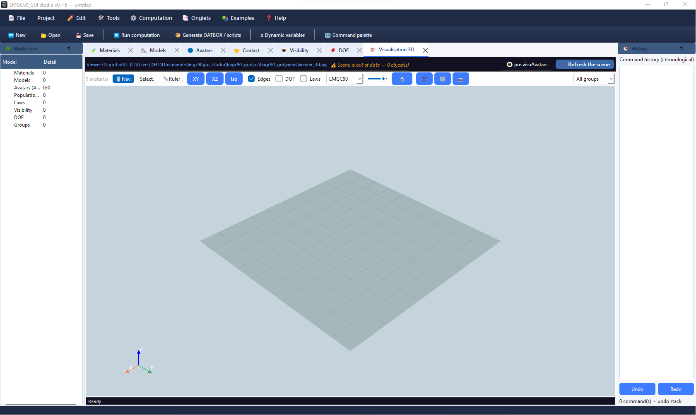

# LMGC90 GUI Studio

Monorepo to build, visualise and export **LMGC90** scenes (DEM / contact) 




With a decoupled architecture:

| Package | Role | Heavy dependencies |
|---------|------|--------------------|
| **`lmgc90_core`** | Pure data model (materials, models, avatars, laws, loops, granulo SoA, masonry) + `pre.py` script generation | **none** (Python + NumPy) |
| **`lmgc90_engine`** | Bridge to **pylmgc90**: live materialisation, DATBOX, `pre.visuAvatars`, workers; **`schema/`** (introspection, snapshots, audit) | **pylmgc90 optional** |
| **`lmgc90_gui`** | **PyQt6** client (MVC): CRUD tabs, wizards, Viewer3D, journal, compute | Qt; PyVista optional |

You can **install core only**, build a dataset (`.lmgc90` project / scripts), then add engine + GUI later — without rewriting the scene.

```
lmgc90gui_studio/
├── lmgc90_core/          # pure scientific core
├── lmgc90_engine/        # pylmgc90 bridge
├── lmgc90_gui/           # Qt interface
├── examples/             # demo scenes (if present)
├── docs/                 # notes / documented examples
├── install.ps1           # quick Windows install
├── pyproject.toml        # meta (does not replace the 3 packages)
└── README.md             # this file
```

---

## Architecture

```text
                    ┌─────────────────────────────────────┐
                    │           lmgc90_gui (Qt)           │
                    │  ProjectController · tabs · UI      │
                    └───────────────┬─────────────────────┘
                                    │
                    ┌───────────────▼─────────────────────┐
                    │         lmgc90_engine               │
                    │  EngineSession · materialize        │
                    │  writeDatbox · visuAvatars          │
                    │  schema/ (catalogues · snapshots)   │
                    └───────────────┬─────────────────────┘
                                    │  (if pylmgc90 available)
                    ┌───────────────▼─────────────────────┐
                    │         lmgc90_core                 │
                    │  Project · entities · ForLoop       │
                    │  granulo SoA · masonry · emit pre   │
                    │  capabilities/*.json (snapshots)    │
                    └─────────────────────────────────────┘
```

- **Core** is the source of truth for the **scene**: project serialisation, LMGC90 5-char names, dimension, expressions / loops. It also embeds **versioned capability snapshots** (JSON) under `lmgc90_core/capabilities/` so catalogues work without importing pylmgc90.
- **Engine** does not own the scene; it **materialises** a `Project` into `pylmgc90.pre` objects when the library is importable. Subpackage **`lmgc90_engine.schema`** introspects runtime catalogues (`lmgc90dicts`), builds snapshots, and audits drift.
- **GUI** does not store pylmgc bodies in the controller; the engine session holds live objects after `materialize()`. Form helpers may read catalogues via schema (live or snapshot).

Without pylmgc90 you still get: project editing, `pre.py` / `command.py` export, **parametric** Viewer3D (PyVista), and catalogue-driven forms from the **bundled snapshot** (or core hard-coded fallbacks if no JSON is present).  
With pylmgc90: real DATBOX, `pre.visuAvatars`, native granulo deposit, and **live** catalogue introspection when available.

---

## Capability catalogues (`schema` + core snapshots)

LMGC90 option lists and compatibility tables live upstream in **`lmgc90dicts`** (inside pylmgc90). The studio does **not** import that module from the GUI or from core. Instead:

| Priority | Source | When |
|----------|--------|------|
| 1. **INTROSPECTION** | Live `pylmgc90.pre.config.lmgc90dicts` (whitelist `_CATALOG_NAMES`) | `pylmgc90` importable and dicts readable |
| 2. **SNAPSHOT** | Bundled JSON in `lmgc90_core/capabilities/` | No live dicts; snapshot files present |
| 3. **FALLBACK** | Hard-coded tables in `lmgc90_core.lmgc_dicts` | Neither runtime nor snapshot |

**Engine (`lmgc90_engine.schema`)**

| Module | Role |
|--------|------|
| `introspection.py` | Runtime catalogues + `inspect_runtime()` (pre/chipy APIs + dicts) |
| `snapshot.py` | CLI / API to write versioned JSON + `index.json` |
| `laws.py` / `model_options.py` | Helpers for contact laws and model options (GUI-oriented) |
| `audit.py` | Read-only drift report: core catalogues vs installed pylmgc90 |

**Generate or refresh a snapshot** (machine where pylmgc90 is installed; **not** done automatically at GUI startup):

```bash
lmgc90-engine-snapshot
# optional:
lmgc90-engine-snapshot --output-dir /path/to/lmgc90_core/src/lmgc90_core/capabilities
```

This writes `pylmgc90-<version>.json` (catalogues from `lmgc90dicts` + pre/chipy API metadata) and updates `index.json`. Commit those files into the core package so other machines can run without pylmgc90.

The GUI status bar can show the active source (`INTROSPECTION` / `SNAPSHOT` / `FALLBACK`) via `compatibility_catalog_source()`.

---

## Requirements

- **Python ≥ 3.10**
- **NumPy**
- **Optional GUI**: `PyQt6`
- **Optional 3D viewer**: `pyvista`, `pyvistaqt`
- **Optional LMGC90 compute**: **pylmgc90** (from **source** / **conda** env — not a typical public PyPI package)

---

## Progressive installation (recommended)

### Step A — Core only (data + scripts, headless)

```bash
cd lmgc90gui_studio
pip install -e ./lmgc90_core
```

Minimal example:

```python
from lmgc90_core import pre, Project

p = Project(name="demo", dimension=2)
p.add(pre.material(name="STEEL", materialType="RIGID", density=7800.0))
p.add(pre.model(name="rigid", physics="MECAx", element="Rxx2D", dimension=2))
p.add(pre.rigidDisk(r=0.1, center=[0.0, 0.0], model="rigid", material="STEEL"))

print(p.summary())
```

You can **create and version a dataset** (scene) before installing Qt or pylmgc90.

### Step B — Engine (pylmgc90 bridge)

```bash
pip install -e ./lmgc90_engine
```

- If `import pylmgc90` succeeds → `EngineSession.materialize()`, DATBOX write, `visu_avatars()`.
- Otherwise → script generation still works; live materialisation is disabled.
- Optional: refresh capability snapshots with `lmgc90-engine-snapshot` when pylmgc90 is available.

### Step C — GUI

```bash
pip install -e "./lmgc90_gui[qt]"
# 3D viewer (PyVista):
pip install -e "./lmgc90_gui[viz]"
# or:
pip install pyvista pyvistaqt

lmgc90-gui
```

### Windows (PowerShell) — all at once

```powershell
cd C:\Users\DELL\Documents\lmgc90gui_studio
.\install.ps1
```

See **[README_INSTALL.md](./README_INSTALL.md)** for a short reminder.

---

## pylmgc90

`pylmgc90` is optional for core + many GUI workflows. Install it in the **same** Python/conda environment as the studio packages when you need live materialisation / DATBOX / `pre.visuAvatars`.

In the GUI: **👁 pre.visuAvatars** (materialise then native LMGC90 viewer) when `pylmgc_available()` is true.

---

## Running the GUI

```bash
lmgc90-gui
# equivalent:
python -m lmgc90_gui
```

Main tabs (evolving): Materials, Models, Avatars, Contact, Visibility, DOF, Groups, Contactors, Granulo, Loops, deformable / masonry assistants, **3D Visualisation**, etc.

- **Refresh scene**: parametric PyVista render (manual, for large projects).
- **pre.visuAvatars**: real pylmgc90 bodies (if the library is present).

---

## Tests

```bash
cd lmgc90_core && python -m pytest -q
cd ../lmgc90_engine && python -m pytest -q
cd ../lmgc90_gui && python -m pytest -q
```

**Core / engine** tests stay headless (no Qt / no mandatory pylmgc90 where possible).

---

## Development

1. Fork / clone this repository.
2. Python 3.10+ env (ideally conda if you rely on pylmgc90).
3. Editable install of the three packages (order: core → engine → gui).
4. Prefer PRs scoped by layer (`core`, `engine`, `gui`).

Useful conventions:

- LMGC90 names are often constrained (e.g. 5 characters for some identifiers).
- The GUI must not reintroduce `_pylmgc_*` containers in the controller.
- Scientific geometry lives in **core**; the legacy 3D viewer is ported in `lmgc90_gui/views/viewer_3d.py`.
- Capability catalogues: prefer **schema** helpers over hard-coded option lists in the GUI; refresh snapshots on pylmgc90 upgrades.

---

## Quick troubleshooting

| Symptom | Hint |
|---------|------|
| Root `pip install -e .` does not install the apps | Install each sub-package (`lmgc90_core`, …) |
| `No module named 'lmgc90_gui.views.viewer_3d'` | Missing file or bad install → check `views\viewer_3d.py`, then `UPDATE_VIEWER.ps1` |
| Import path under `lmgc90_engine\src\lmgc90_gui\...` | Wrong tree / duplicate copy → reinstall from `lmgc90_gui\` |
| `pylmgc_available() == False` | Wrong Python env; reinstall the GUI inside the conda env that has pylmgc90 |
| Status bar shows `FALLBACK` | No live dicts and no bundled snapshot JSON → run `lmgc90-engine-snapshot` on a pylmgc90 machine and commit `capabilities/` |
| Empty 3D viewer | Create avatars then **Refresh scene**; install `pyvista pyvistaqt` |
| Locale decimals `0,5` (FR) | Numeric fields accept a comma; prefer a dot in scripts |

---

## Licence / author

Open Source — **Bachir Zerourou**.  
Related to the [LMGC90](https://git-xen.lmgc.univ-montp2.fr/lmgc90) ecosystem and the historical [LMGC90_MVC_GUI](https://github.com/bzerourou/LMG90_GUI_MVC/).

---

## Package READMEs

- `lmgc90_core/README.md` — Project / pre / populations API; bundled `capabilities/` snapshots  
- `lmgc90_engine/README.md` — EngineSession / materialize / DATBOX / **schema** (introspection, snapshot, audit)  
- `lmgc90_gui/README.md` — GUI launch / extras `[qt]` `[viz]`  
