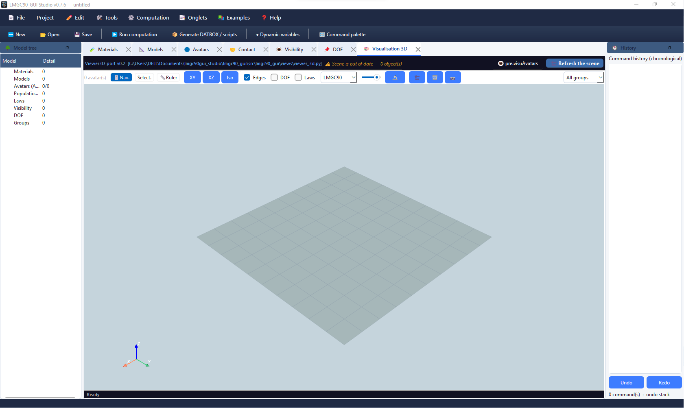

# LMGC90 GUI Studio

Monorepo pour construire, visualiser et exporter des scènes **LMGC90** (DEM / contact) 



Avec une architecture découplée :

| Package | Rôle | Dépendances lourdes |
|---------|------|---------------------|
| **`lmgc90_core`** | Modèle de données pur (matériaux, modèles, avatars, lois, boucles, granulo SoA, maçonnerie) + génération de scripts `pre.py` | **aucune** (Python + NumPy) |
| **`lmgc90_engine`** | Pont vers **pylmgc90** : matérialisation live, DATBOX, `pre.visuAvatars`, workers ; **`schema/`** (introspection, snapshots, audit) | **pylmgc90 optionnel** |
| **`lmgc90_gui`** | Client **PyQt6** (MVC) : onglets CRUD, assistants, Viewer3D, journal, calcul | Qt ; PyVista optionnel |

Tu peux **n’installer que le core**, construire un jeu de données (projet `.lmgc90` / scripts), puis ajouter engine + GUI plus tard — sans réécrire la scène.

```
lmgc90gui_studio/
├── lmgc90_core/          # scientifique pur
├── lmgc90_engine/        # bridge pylmgc90
├── lmgc90_gui/           # interface Qt
├── examples/             # scènes de démo (si présentes)
├── docs/                 # notes / exemples documentés
├── install.ps1           # install Windows rapide
├── pyproject.toml        # méta (ne remplace pas les 3 packages)
└── README.md             # ce fichier
```

---

## Architecture

```text
                    ┌─────────────────────────────────────┐
                    │           lmgc90_gui (Qt)           │
                    │  ProjectController · onglets · UI   │
                    └───────────────┬─────────────────────┘
                                    │
                    ┌───────────────▼─────────────────────┐
                    │         lmgc90_engine               │
                    │  EngineSession · materialize        │
                    │  writeDatbox · visuAvatars          │
                    │  schema/ (catalogues · snapshots)   │
                    └───────────────┬─────────────────────┘
                                    │  (si pylmgc90 dispo)
                    ┌───────────────▼─────────────────────┐
                    │         lmgc90_core                 │
                    │  Project · entities · ForLoop       │
                    │  granulo SoA · masonry · emit pre   │
                    │  capabilities/*.json (snapshots)    │
                    └─────────────────────────────────────┘
```

- **Core** : source de vérité de la **scène** (sérialisation projet, noms 5 caractères LMGC90, dimension, expressions / boucles). Il embarque aussi des **snapshots de capacités** versionnés (JSON) sous `lmgc90_core/capabilities/`, pour les catalogues sans importer pylmgc90.
- **Engine** : ne possède pas la scène ; il **matérialise** un `Project` en objets `pylmgc90.pre` quand la lib est importable. Le sous-package **`lmgc90_engine.schema`** introspecte les catalogues runtime (`lmgc90dicts`), produit les snapshots et audite la dérive.
- **GUI** : ne stocke pas de corps pylmgc dans le contrôleur ; la session engine détient les objets live après `materialize()`. Les formulaires peuvent lire les catalogues via schema (live ou snapshot).

Sans pylmgc90, tu gardes : édition de projet, export scripts `pre.py` / `command.py`, Viewer3D **paramétrique** (PyVista), et formulaires pilotés par le **snapshot emballé** (ou les fallbacks codés en dur du core s’il n’y a pas de JSON).  
Avec pylmgc90 : DATBOX réel, `pre.visuAvatars`, dépôt granulo natif, et introspection **live** des catalogues quand elle est disponible.

---

## Catalogues de capacités (`schema` + snapshots core)

Les listes d’options et tables de compatibilité LMGC90 vivent en amont dans **`lmgc90dicts`** (dans pylmgc90). Le studio **n’importe pas** ce module depuis la GUI ni depuis le core. À la place :

| Priorité | Source | Quand |
|----------|--------|------|
| 1. **INTROSPECTION** | `pylmgc90.pre.config.lmgc90dicts` live (liste `_CATALOG_NAMES`) | `pylmgc90` importable et dicts lisibles |
| 2. **SNAPSHOT** | JSON emballé dans `lmgc90_core/capabilities/` | Pas de dicts live ; fichiers snapshot présents |
| 3. **FALLBACK** | Tables en dur dans `lmgc90_core.lmgc_dicts` | Ni runtime ni snapshot |

**Engine (`lmgc90_engine.schema`)**

| Module | Rôle |
|--------|------|
| `introspection.py` | Catalogues runtime + `inspect_runtime()` (APIs pre/chipy + dicts) |
| `snapshot.py` | CLI / API d’écriture du JSON versionné + `index.json` |
| `laws.py` / `model_options.py` | Helpers lois de contact et options de modèle (côté GUI) |
| `audit.py` | Rapport en lecture seule : catalogues core vs pylmgc90 installé |

**Générer ou rafraîchir un snapshot** (machine où pylmgc90 est installé ; **pas** automatique au démarrage de la GUI) :

```bash
lmgc90-engine-snapshot
# optionnel :
lmgc90-engine-snapshot --output-dir /chemin/vers/lmgc90_core/src/lmgc90_core/capabilities
```

Écrit `pylmgc90-<version>.json` (catalogues issus de `lmgc90dicts` + métadonnées d’API pre/chipy) et met à jour `index.json`. Commiter ces fichiers dans le package core permet aux autres machines de tourner sans pylmgc90.

La barre de statut de la GUI peut afficher la source active (`INTROSPECTION` / `SNAPSHOT` / `FALLBACK`) via `compatibility_catalog_source()`.

---

## Prérequis

- **Python ≥ 3.10**
- **NumPy**
- **Optionnel GUI** : `PyQt6`
- **Optionnel Viewer 3D** : `pyvista`, `pyvistaqt`
- **Optionnel calcul LMGC90** : **pylmgc90** (install depuis les **sources** / env **conda**, pas sur PyPI public classique)

---

## Installation progressive (recommandé)

### Étape A — Core seul (données + scripts, headless)

```bash
cd lmgc90gui_studio
pip install -e ./lmgc90_core
```

Exemple minimal :

```python
from lmgc90_core import pre, Project

p = Project(name="demo", dimension=2)
p.add(pre.material(name="STEEL", materialType="RIGID", density=7800.0))
p.add(pre.model(name="rigid", physics="MECAx", element="Rxx2D", dimension=2))
p.add(pre.rigidDisk(r=0.1, center=[0.0, 0.0], model="rigid", material="STEEL"))

# Persistance / scripts (API du package — voir lmgc90_core/README.md)
print(p.summary())
```

Tu peux ainsi **créer et versionner un jeu de données** (scène) avant d’installer Qt ou pylmgc90.

### Étape B — Engine (bridge pylmgc90)

```bash
pip install -e ./lmgc90_engine
```

- Si `import pylmgc90` réussit → `EngineSession.materialize()`, écriture DATBOX, `visu_avatars()`.
- Sinon → génération de scripts toujours possible ; matérialisation live désactivée.
- Optionnel : rafraîchir les snapshots avec `lmgc90-engine-snapshot` quand pylmgc90 est disponible.

### Étape C — GUI

```bash
pip install -e "./lmgc90_gui[qt]"
# Viewer 3D (PyVista) :
pip install -e "./lmgc90_gui[viz]"
# ou :
pip install pyvista pyvistaqt

lmgc90-gui
```

### Windows (PowerShell) — tout d’un coup

```powershell
cd C:\Users\DELL\Documents\lmgc90gui_studio
.\install.ps1
```

Voir **[README_INSTALL.md](./README_INSTALL.md)** pour un rappel court.

---

## pylmgc90

`pylmgc90` est optionnel pour le core et une grande partie de la GUI. Installe-le dans le **même** environnement Python/conda que les packages du studio lorsque tu as besoin de matérialisation live / DATBOX / `pre.visuAvatars`.

Dans la GUI : **👁 pre.visuAvatars** (matérialiser puis viewer natif LMGC90) si `pylmgc_available()` est vrai.

---

## Lancer la GUI

```bash
lmgc90-gui
# équivalent :
python -m lmgc90_gui
```

Onglets principaux (évolutifs) : Materials, Models, Avatars, Contact, Visibility, DOF, Groups, Contactors, Granulo, Loops, assistants déformables / maçonnerie, **Visualisation 3D**, etc.

- **Rafraîchir la scène** : rendu PyVista paramétrique (manuel, pour gros projets).
- **pre.visuAvatars** : corps pylmgc90 réels (si lib présente).

---

## Tests

```bash
cd lmgc90_core && python -m pytest -q
cd ../lmgc90_engine && python -m pytest -q
cd ../lmgc90_gui && python -m pytest -q
```

Les tests **core / engine** restent headless (sans Qt / sans pylmgc obligatoires dans la mesure du possible).

---

## Développement

1. Fork / clone ce dépôt.
2. Env Python 3.10+ (idéalement conda si tu relies pylmgc90).
3. Install editable des 3 packages (ordre core → engine → gui).
4. Branches / PR par couche de préférence (`core`, `engine`, `gui`).

Conventions utiles :

- Noms LMGC90 souvent limités (ex. 5 caractères pour certains identifiants).
- La GUI ne doit pas réintroduire de conteneurs `_pylmgc_*` dans le contrôleur.
- Toute géométrie « scientifique » vit dans **core** ; le rendu 3D legacy est porté dans `lmgc90_gui/views/viewer_3d.py`.
- Catalogues de capacités : préférer les helpers **schema** aux listes d’options en dur dans la GUI ; régénérer les snapshots lors des montées de version pylmgc90.

---

## Dépannage rapide

| Symptôme | Piste |
|----------|--------|
| `pip install -e .` à la racine ne trouve pas le projet | Installer chaque sous-package (`lmgc90_core`, …) |
| `No module named 'lmgc90_gui.views.viewer_3d'` | Fichier absent ou mauvais install → `dir ...\views\viewer_3d.py` puis `UPDATE_VIEWER.ps1` |
| Import depuis `lmgc90_engine\src\lmgc90_gui\...` | Mauvaise arborescence / double copie → réinstaller depuis `lmgc90_gui\` |
| `pylmgc_available() == False` | Mauvais env Python ; réinstaller GUI dans l’env conda de pylmgc90 |
| Barre de statut `FALLBACK` | Pas de dicts live et pas de JSON snapshot emballé → lancer `lmgc90-engine-snapshot` sur une machine pylmgc90 et committer `capabilities/` |
| Viewer 3D vide | Créer des avatars puis **Rafraîchir la scène** ; installer `pyvista pyvistaqt` |
| Décimales `0,5` (locale FR) | Les champs numériques acceptent la virgule ; préférer le point dans les scripts |

---

## Licence / auteur

Open Source — **Bachir Zerourou**.  
Projet lié à l’écosystème [LMGC90](https://git-xen.lmgc.univ-montp2.fr/lmgc90) et à l’historique [LMGC90_GUI_MVC](https://github.com/bzerourou/LMG90_GUI_MVC/).

---

## Liens packages

- `lmgc90_core/README.md` — API Project / pre / populations ; snapshots `capabilities/`  
- `lmgc90_engine/README.md` — EngineSession / materialize / DATBOX / **schema** (introspection, snapshot, audit)  
- `lmgc90_gui/README.md` — lancement GUI / extras `[qt]` `[viz]`  
