# LMGC90 Studio — Detailed architecture

> **Version:** 0.6.0  > **Author:** bzerourou  > **class diagrams** and **sequence diagrams** for the **core / engine / gui** architecture.
---

## Table of contents

1. [Overview](#1-overview)
2. [Class diagram — core](#2-class-diagram--lmgc90_core)
3. [Class diagram — engine](#3-class-diagram--lmgc90_engine)
4. [Class diagram — gui](#4-class-diagram--lmgc90_gui)
5. [Class diagram — cross-cutting](#5-class-diagram--cross-cutting-view)
6. [Sequences — CRUD & history](#6-sequences--crud--history)
7. [Sequences — materialize & DATBOX](#7-sequences--materialize--datbox)
8. [Sequences — granulo](#8-sequences--granulo)
9. [Sequences — multi-target ForLoop](#9-sequences--multi-target-forloop)
10. [Sequences — open project / Undo](#10-sequences--open-project--undo)
11. [Sequences — visu & script export](#11-sequences--visu--script-export)
12. [Architecture rules](#12-architecture-rules)

---

## 1. Overview

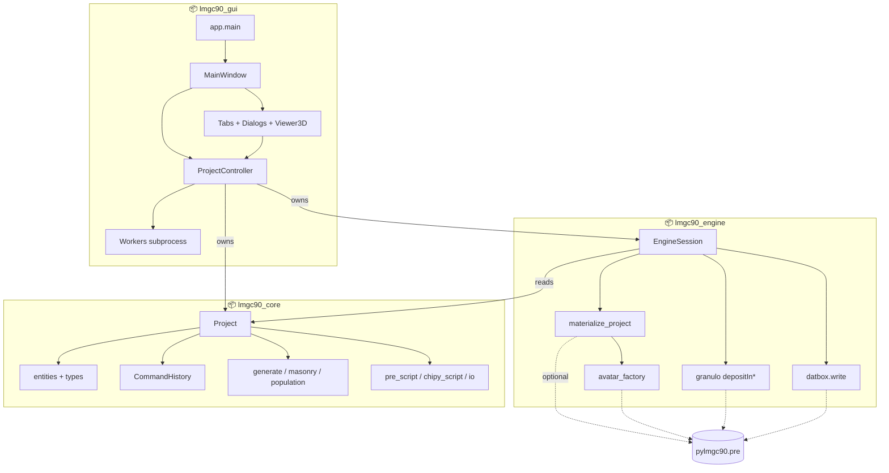

| Package | Role | Dependencies |
|---------|------|-------------|
| **core** | Model truth, Undo, serialisation, scripts | Python + NumPy |
| **engine** | Live materialisation, DATBOX, native deposits | core + optional pylmgc90 |
| **gui** | MVC interface | core + engine + PyQt6 (+ PyVista) |

---

## 2. Class diagram — `lmgc90_core`

### 2.1 Project and aggregates

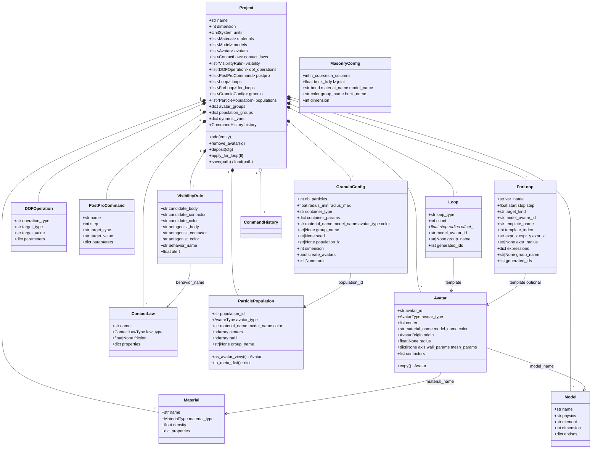

### 2.2 Command history (Undo / Redo)

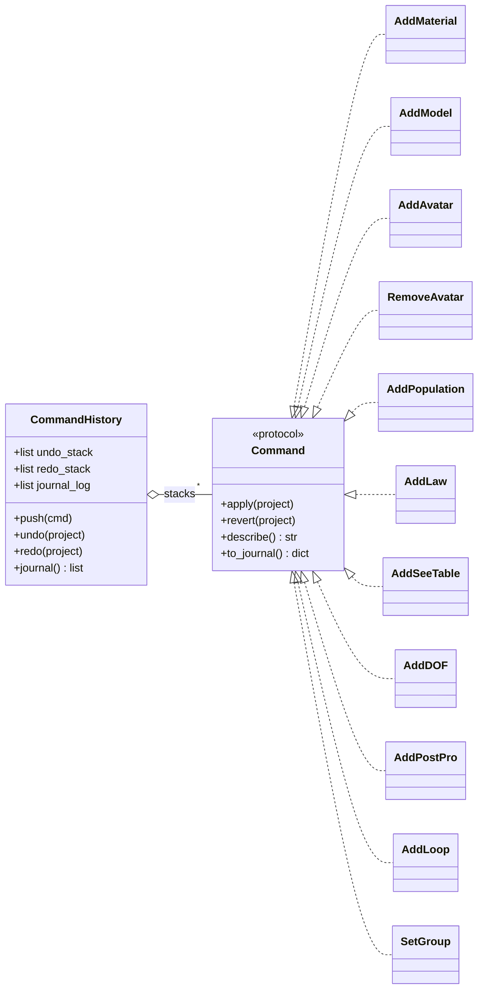

### 2.3 Types & validation (excerpt)

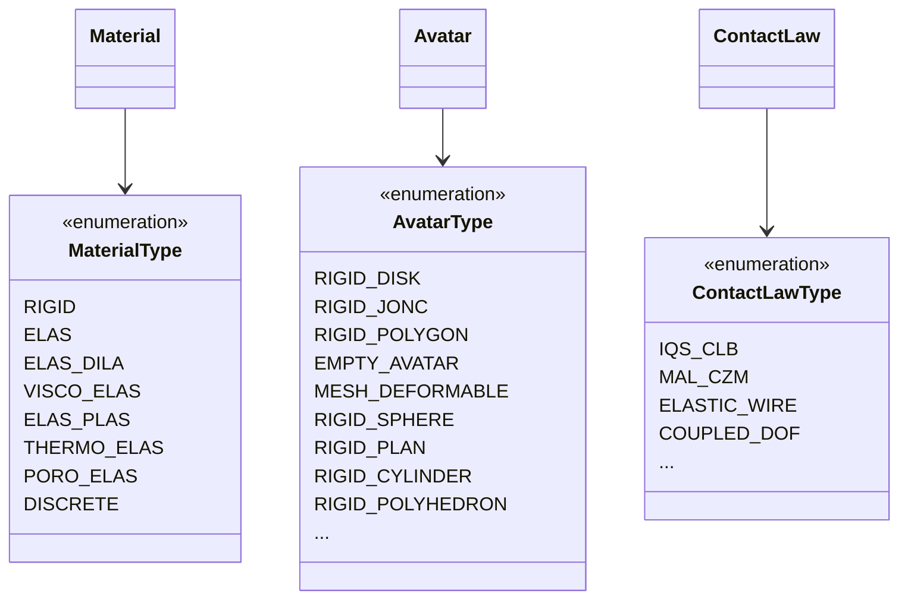

Related constants: `MATERIAL_PROPERTY_SCHEMA`, `ORTHOTROPIC_FIELDS_2D/3D`, `CONTACTORS_RIGID_2D/3D`, `CONTACT_LAW_PROPERTY_SCHEMA`.

---

## 3. Class diagram — `lmgc90_engine`

```mermaid
classDiagram
  direction TB

  class EngineSession {
    +Project project
    +MaterializedScene|None _scene
    +bool _dirty
    --
    +mark_dirty()
    +materialize(force) MaterializedScene
    +write_datbox(path, ...)
    +visu_avatars(force)
    +emit_pre_script(path) str
    +emit_chipy_script(...) str
    +export_all(outdir)
    +run_granulo(cfg) ParticlePopulation
    +available() bool
  }

  class MaterializedScene {
    +Any materials_container
    +Any models_container
    +Any bodies_container
    +dict material_by_name
    +dict model_by_name
    +dict body_by_avatar_id
    +dict law_by_name
    +int dimension
    +str project_name
  }

  class materialize_project {
    <<function>>
    +materialize_project(project) MaterializedScene
  }

  class avatar_factory {
    <<module>>
    +build_avatar(av, ...)
    +build_population_bodies(pop, ...)
    +_apply_contactors(...)
  }

  class granulo {
    <<module>>
    +deposit_population(config) ParticlePopulation
  }

  class datbox {
    <<module>>
    +write_datbox(scene, path)
    +write_cell_dual_datbox(...)
  }

  EngineSession --> Project : reference
  EngineSession o-- MaterializedScene
  EngineSession ..> materialize_project
  EngineSession ..> granulo
  EngineSession ..> datbox
  materialize_project ..> avatar_factory
  MaterializedScene ..> "pylmgc90.pre" : live containers
```

**Materialize chain (order)**:

1. `pre.materials()` ← each `Material` (`_make_material`, orthotropic → `young`/`nu`/`G` lists)
2. `pre.models()` ← each `Model` (`dimension` ∈ {2,3}, name 5 char.)
3. Bodies ← `build_avatar` / populations / mesh expand
4. `tact_behav` ← laws
5. `see_table` ← visibility
6. DOF ← `imposeDrivenDof` / evolution / …

---

## 4. Class diagram — `lmgc90_gui`

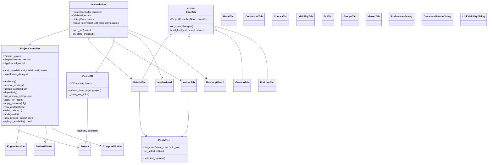

---

## 5. Class diagram — cross-cutting view

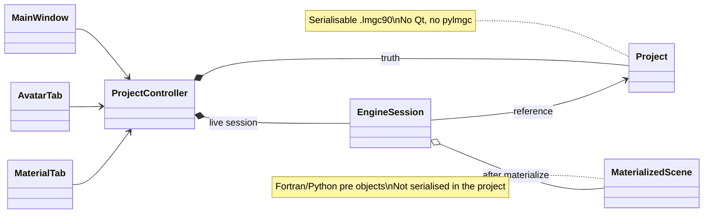

---

## 6. Sequences — CRUD & history

### 6.1 Adding a material

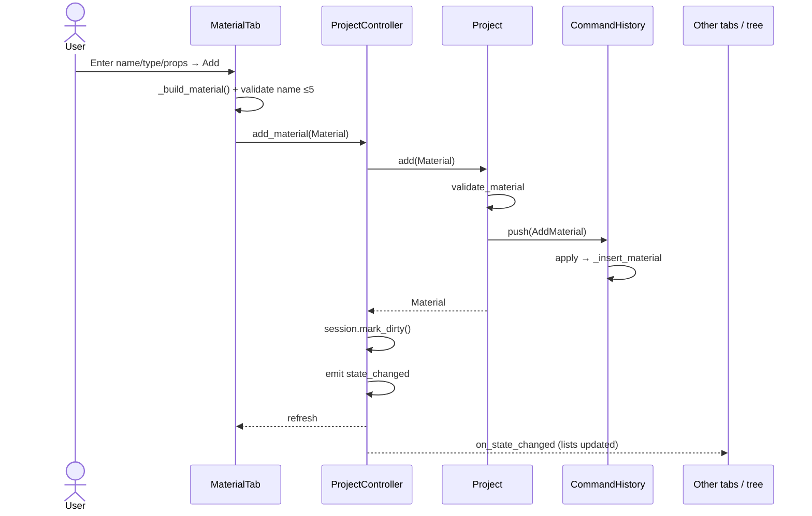

### 6.2 Deleting an avatar

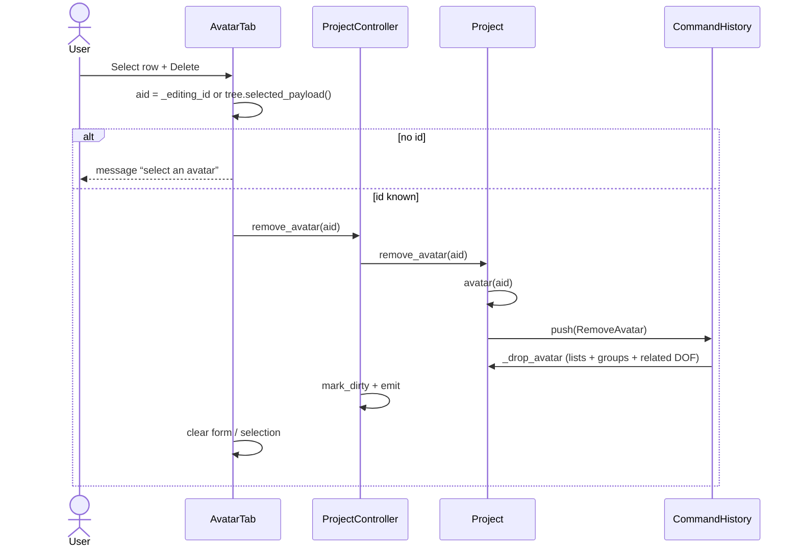

### 6.3 Undo

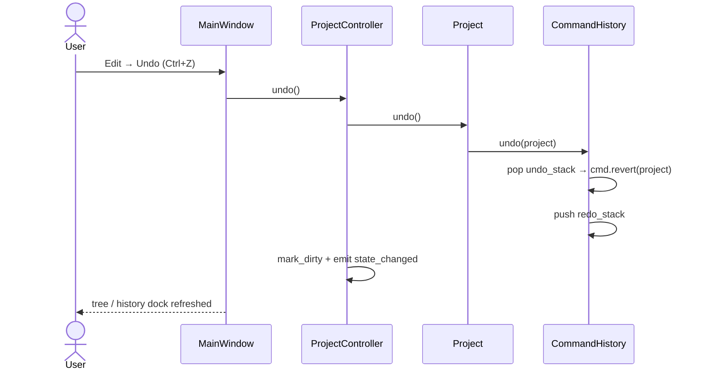

---

## 7. Sequences — materialize & DATBOX

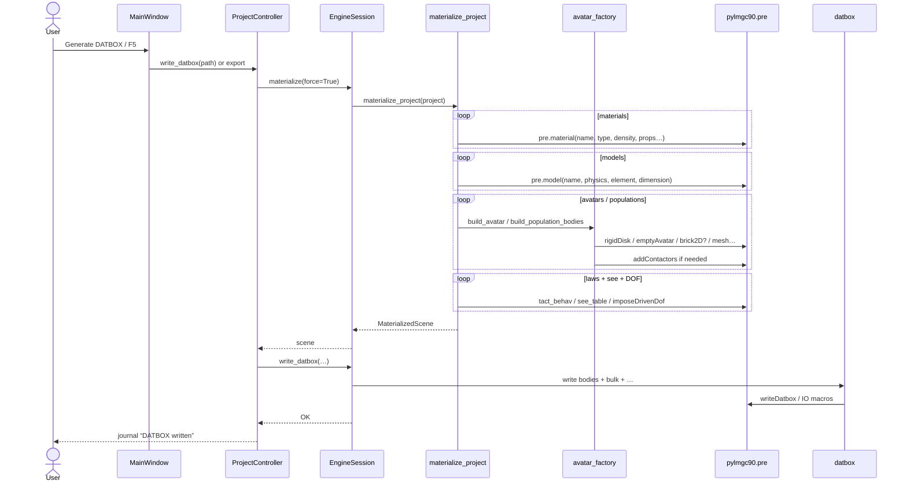

### emptyAvatar (detail)

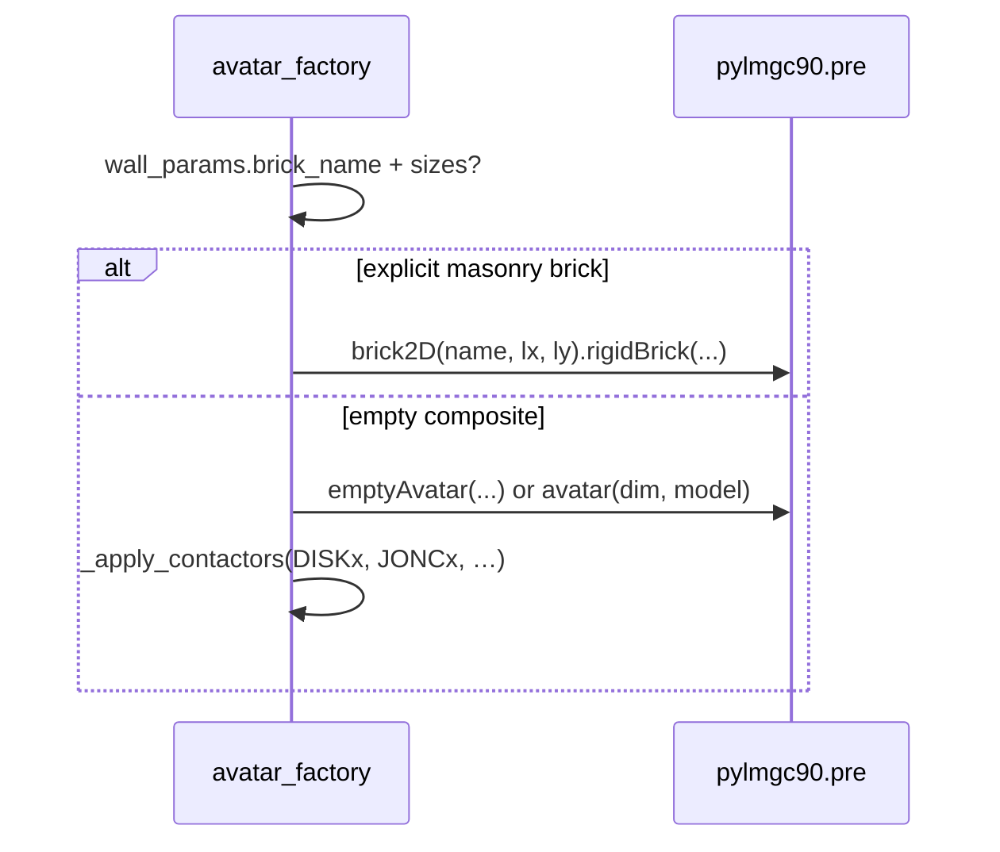

---

## 8. Sequences — granulo

### 8.1 Distribution only (no avatars)

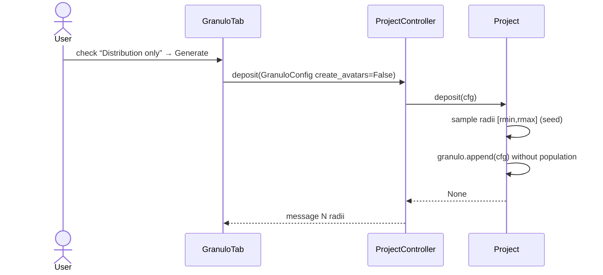

### 8.2 SoA or pylmgc deposit

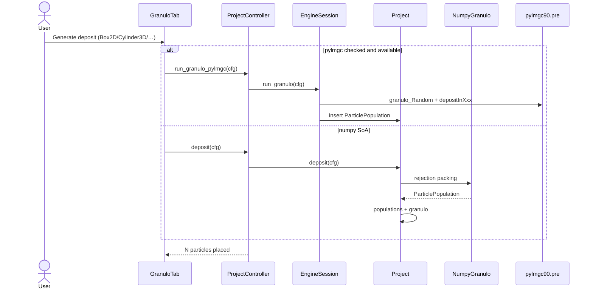

---

## 9. Sequences — multi-target ForLoop

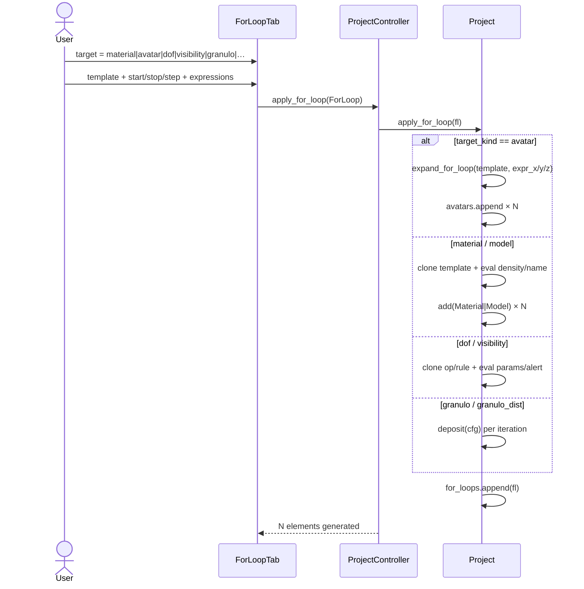

---

## 10. Sequences — open project / Undo

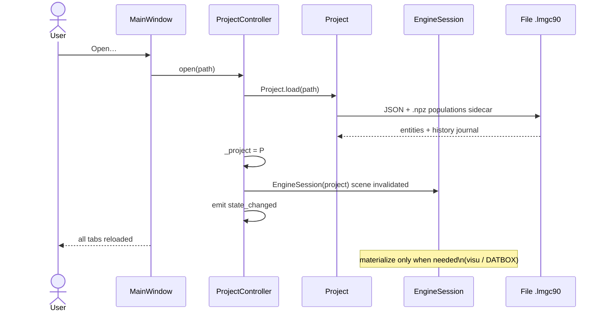

---

## 11. Sequences — visu & script export

### 11.1 Parametric viewer (no mandatory materialize)

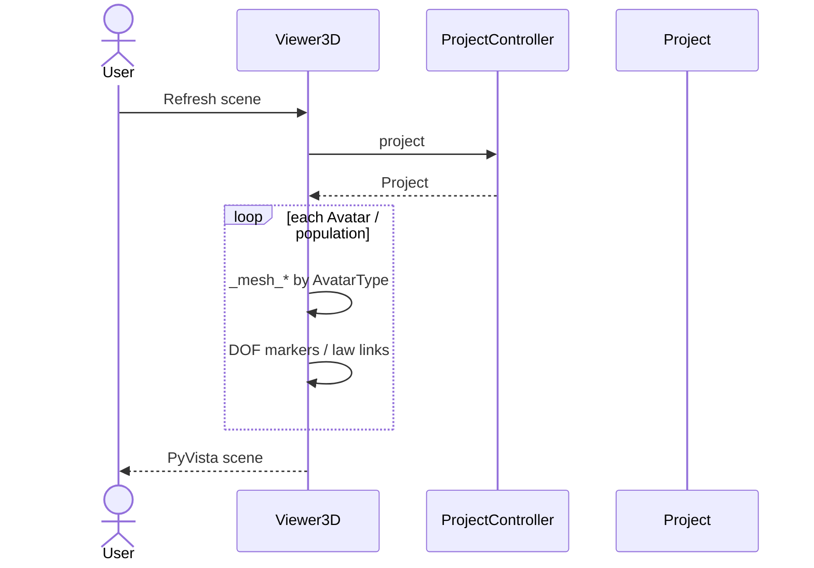

### 11.2 pre.visuAvatars (pylmgc)

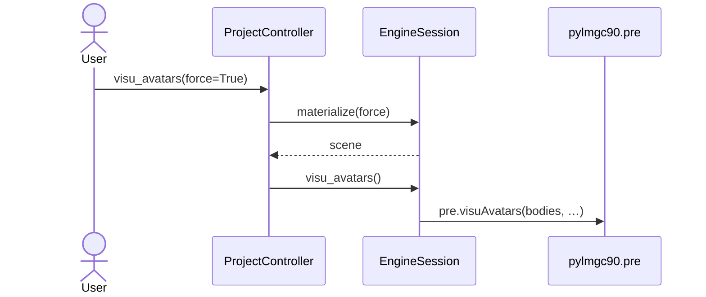

### 11.3 Export pre.py (pure core)

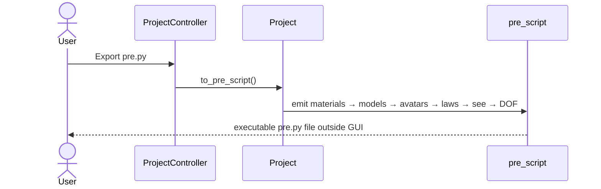

---

## 12. Architecture rules

1. **Source of truth** = `lmgc90_core.Project` (never the pylmgc containers).
2. **core**: zero Qt / pylmgc90 imports (headless tests).
3. **engine**: materialises on demand; `mark_dirty` after every GUI mutation.
4. **gui**: `ProjectController` = sole façade; tabs do not touch `pre` directly (except core `pre.*` helpers to build entities).
5. **LMGC90 names** = 5 characters at export / materialize.
6. **emptyAvatar** ≠ brick: brick only if `wall_params.brick_name` + dimensions.
7. **Examples** = `def scene(project) -> None` in core entities, no Fortran scripts in core.

---

*Studio architecture — detailed classes & sequences (core / engine / gui).*
