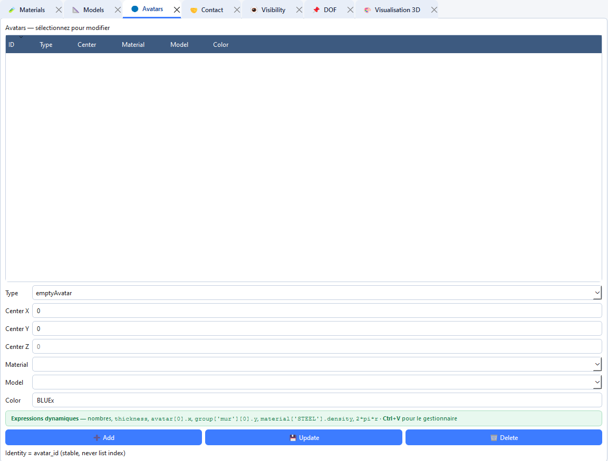

# Create and edit an avatar

An avatar is a body in the scene. It references a material and a model, has a centre and a colour, then geometric parameters specific to its type. Create the material and the model first.



## Create an avatar

1. Open **Tabs → Open → Avatars** (`Ctrl+3`).
2. Choose **Type**. The offered types match the project dimension.
3. Fill in **Center X** and **Center Y**. In 3D, also fill in **Center Z**; that field is inactive in 2D.
4. Choose **Material** and **Model** from the lists.
5. Fill in **Color** with the desired LMGC90 colour code (for example `BLUEx`, `REDxx` or `GRAYx`).
6. Complete **Type parameters**. Fields change automatically when the avatar type changes.
7. Click **Add**. A warning dialog lists missing references or invalid parameters.
8. Refresh the 3D viewer if you want to check placement.

## Types and geometric parameters

Parameter names are those shown under **Type parameters**.

### 2D shapes

| Type | Specific parameters |
|---|---|
| `rigidDisk` | `r`, `is_Hollow` |
| `rigidDiscreteDisk` | `r` |
| `rigidJonc` | `axe1`, `axe2` |
| `rigidPolygon` | `generation_type`, `nb_vertices`, `radius`, `vertices` |
| `rigidOvoidPolygon` | `radius`, `vertices` |
| `rigidCluster` | `r`, `nb_disk` |
| `roughWall` | `l`, `r`, `nb_vertex` |
| `fineWall` | `l`, `r`, `nb_vertex` |
| `smoothWall` | `l`, `h`, `nb_polyg` |
| `granuloRoughWall` | `l`, `rmin`, `rmax`, `nb_vertex` |

### 3D shapes

| Type | Specific parameters |
|---|---|
| `rigidSphere` | `r`, `is_Hollow` |
| `rigidCylinder` | `r`, `h`, `is_Hollow` |
| `rigidPlan` | `axe1`, `axe2`, `axe3` |
| `rigidPolyhedron` | `generation_type`, `nb_vertices`, `radius`, `vertices` |
| `roughWall3D` | `lx`, `ly`, `lz` |
| `granuloRoughWall3D` | `lx`, `ly`, `lz`, `rmin`, `rmax` |

`emptyAvatar` and `mesh` also appear in the list. Their procedures are detailed in [Empty avatar](empty_avatar.md) and [Deformable body](empty_avatar.md#avatar-mesh) or [Deformable wizard](meshed.md).

## Polygons and custom vertices

For a regular polygon or polyhedron, keep `generation_type` as `regular`, then fill in the number of vertices and the radius. For an explicit geometry, enter coordinates in **vertices**, separated by semicolons:

```text
x1,y1; x2,y2; x3,y3
```

In 3D, each vertex must contain its `x,y,z` coordinates. Vertices must form a valid geometry and contain at least three points in 2D or four in 3D.

## Expressions and dimension

Centre numeric fields and several parameters accept a numeric value or a project expression. For example, a radius can reuse a variable defined under **Tools → Dynamic variables…**. An unresolved expression triggers a warning when adding.

In 2D, the centre has two coordinates. In 3D, it has three. Use a model of the same dimension; rigid types must be associated with the rigid element of that dimension (`Rxx2D` or `Rxx3D`).

## Edit an avatar

1. Select the avatar row in the upper list.
2. Common fields and parameters available for its type are reloaded.
3. Change the required values.
4. Click **Update**.

## Delete an avatar

Select the avatar then click **Delete**. Check groups, DOF conditions and other rules that may have targeted it. Deleting the avatar does not necessarily mean that all functional references in the project have been reinterpreted.

## Colour and contact

Colour is also used to select bodies in **Visibility** tables and in DOF operations targeted by colour. Keep a consistent colour code between the avatar, its contactor and the visibility table. Adding extra contact shapes is documented in [Contactors](contactors.md).

Example colours you may use:

| Code | Colour |
|------|--------|
| `BLUEx` | Blue |
| `REDxx` | Red |
| `VERTx` | Green |
| `JAUNx` | Yellow |
| `GRAYx` | Grey |
| `BLACx` | Black |
| `WHITx` | White |
| `ORANx` | Orange |
| `CYANx` | Cyan |
| `MAGEx` | Magenta |
| `VIOLx` | Violet |
| `ROSEx` | Pink |

## 2D avatar types

### 1. rigidDisk — Rigid 2D disk

Rigid circular body in 2D. The most common type for granular simulations.

| Parameter | Description | Example |
|-----------|-------------|--------|
| `r` (radius) | Disk radius (m). | `0.1` |
| `is_hollow` | If checked, creates a hollow disk (`is_Hollow=True`). Useful for rigid rings. | checkbox |

---

### rigidJonc — Rigid 2D jonc / ellipse

Rigid elliptical body in 2D. Defined by two semi-axes.

| Parameter | Description | Example |
|-----------|-------------|--------|
| `axe1` | Principal semi-axis (m) — length. | `0.15` |
| `axe2` | Secondary semi-axis (m) — width. | `0.05` |

---

### rigidPolygon — Rigid 2D polygon

Rigid polygonal body in 2D. Three generation modes depending on `generation_type`.

| Parameter | Description | Values |
|-----------|-------------|--------|
| `generation_type` | Shape generation mode. | `regular` · `full` · `bevel` |
| `nb_vertices` | Number of vertices (for `regular` and `full`). | `3` to `20` |
| `radius` | Circumscribed circle radius (m) — used for `regular`. Unused for `full` and `bevel`. | `0.1` |
| `vertices` | Explicit vertex list `[[x1,y1],[x2,y2],…]` — used for `full` and `bevel`. | `[[-0.1,-0.1],[0.1,-0.1],[0.,0.1]]` |

**Generation modes:**

- **`regular`**: regular polygon (equal sides). Defined by `nb_vertices` and `radius` (circumscribed circle radius).
- **`full`**: arbitrary polygon from an explicit vertex list. Radius is not used.
- **`bevel`**: polygon with automatic corner chamfering to avoid contact singularities.

---

### rigidOvoidPolygon — Rigid 2D ovoid

Rigid ovoid (polygonal ellipse) body in 2D. Polygonal approximation of an ellipse.

| Parameter | Description | Example |
|-----------|-------------|--------|
| `ra` | Principal semi-axis (m). | `0.15` |
| `rb` | Secondary semi-axis (m). | `0.08` |
| `nb_vertices` | Number of vertices of the polygonal approximation. | `20` |

---

### rigidDiscreteDisk — Rigid 2D discrete disk

Rigid circular body in 2D with discrete kinematics. Same geometry as a `rigidDisk`, but with an `xKSID` contactor (discrete disk). Used in some advanced discrete models.

| Parameter | Description | Example |
|-----------|-------------|--------|
| `r` (radius) | Disk radius (m). | `0.1` |

---

### rigidCluster — Cluster of rigid 2D disks

Rigid 2D body made of several rigidly linked disks. Allows complex non-convex shapes.

| Parameter | Description | Example |
|-----------|-------------|--------|
| `r` | Radius of each disk in the cluster (m). | `0.05` |
| `nb_vertices` (nb_disk) | Number of disks in the cluster. | `4` |

> The parameter is named `nb_disk` in the generated pylmgc90 script (not `nb_vertices`).

---

### roughWall — Rough 2D wall

Rough 2D wall made of aligned disks. Used for confining walls with geometric roughness.

| Parameter | Description | Example |
|-----------|-------------|--------|
| `l` | Total wall length (m). | `2.0` |
| `r` | Radius of the disks forming the roughness (m). | `0.05` |
| `nb_vertex` | Number of disks along the wall. Default: `10`. | `20` |

---

### fineWall — Fine 2D wall

Fine 2D wall made of very small disks. Same parameters as `roughWall` but with finer roughness.

| Parameter | Description | Example |
|-----------|-------------|--------|
| `l` | Total wall length (m). | `2.0` |
| `r` | Disk radius (m). Typically very small (0.001 to 0.01). | `0.005` |
| `nb_vertex` | Number of disks. Default: `10`. | `50` |

---

### smoothWall — Smooth 2D wall

Smooth 2D wall defined by a half-width and a height. Contactor `CLxxx` (continuous surface).

| Parameter | Description | Example |
|-----------|-------------|--------|
| `l` | Half-length of the wall (m) — total length is `2 × l`. | `1.0` |
| `h` | Half-height (thickness) of the wall (m). | `0.01` |
| `nb_polyg` | Number of polygonal segments. Default: `10`. | `20` |

---

### granuloRoughWall — Granular rough 2D wall

2D wall with random roughness generated from a granulometric distribution of disks.

| Parameter | Description | Example |
|-----------|-------------|--------|
| `l` | Total wall length (m). | `2.0` |
| `rmin` | Minimum disk radius (m). | `0.01` |
| `rmax` | Maximum disk radius (m). | `0.05` |
| `nb_vertex` | Number of disks. Default: `10`. | `30` |

---

## 3D avatar types

### rigidSphere — Rigid 3D sphere

Rigid spherical body in 3D. 3D equivalent of `rigidDisk`.

| Parameter | Description | Example |
|-----------|-------------|--------|
| `r` (radius) | Sphere radius (m). | `0.1` |
| `is_hollow` | If checked, creates a hollow sphere (`is_Hollow=True`). | checkbox |

---

### rigidPlan — Rigid 3D plane

Rigid planar surface in 3D. Defined by three direction vectors forming a local frame.

| Parameter | Description | Example |
|-----------|-------------|--------|
| `axe1` | First plane axis vector (local X). | `[1.0, 0.0, 0.0]` |
| `axe2` | Second plane axis vector (local Y). | `[0.0, 1.0, 0.0]` |
| `axe3` | Plane normal (local Z). | `[0.0, 0.0, 1.0]` |

> The three vectors must form a right-handed orthonormal basis.

---

### rigidCylinder — Rigid 3D cylinder

Rigid cylindrical body in 3D.

| Parameter | Description | Example |
|-----------|-------------|--------|
| `r` (radius) | Cylinder radius (m). | `0.1` |
| `h` | Height (axial length) of the cylinder (m). Default: `1.0` if absent. | `0.5` |
| `is_hollow` | If checked, creates a hollow cylinder (`is_Hollow=True`). | checkbox |

---

### rigidPolyhedron — Rigid 3D polyhedron

Rigid polyhedral body in 3D. Two generation modes depending on `generation_type`.

| Parameter | Description | Values |
|-----------|-------------|--------|
| `generation_type` | Generation mode. | `regular` · `vertices` |
| `nb_vertices` | Number of vertices (for `regular`). | `8` (cube), `12` (icosahedron)… |
| `radius` | Regular polyhedron radius (m) — for `regular`. | `0.1` |
| `vertices` | Explicit 3D vertex list `[[x,y,z],…]` — for `vertices`. | `[[−1,−1,−1],[1,−1,−1],…]` |
| `faces` | Face connectivity `[[i,j,k],…]` (in `wall_params`) — for `vertices`. | `[[0,1,2],[2,3,0],…]` |

**Generation modes:**

- **`regular`**: regular polyhedron (similar to a polygonal sphere). Defined by `nb_vertices` and `radius`.
- **`vertices`**: arbitrary polyhedron defined by an explicit vertex list and face connectivity.

---

### roughWall3D — Rough 3D wall

Rough 3D wall made of spheres aligned on a rectangular surface.

| Parameter | Description | Example |
|-----------|-------------|--------|
| `lx` | Wall dimension in X (m). | `2.0` |
| `ly` | Wall dimension in Y (m). | `2.0` |
| `r` | Roughness sphere radius (m). | `0.05` |

---

### granuloRoughWall3D — Granular rough 3D wall

Rough 3D wall with spheres of random sizes.

| Parameter | Description | Example |
|-----------|-------------|--------|
| `lx` | Dimension in X (m). | `2.0` |
| `ly` | Dimension in Y (m). | `2.0` |
| `rmin` | Minimum sphere radius (m). | `0.01` |
| `rmax` | Maximum sphere radius (m). | `0.05` |
