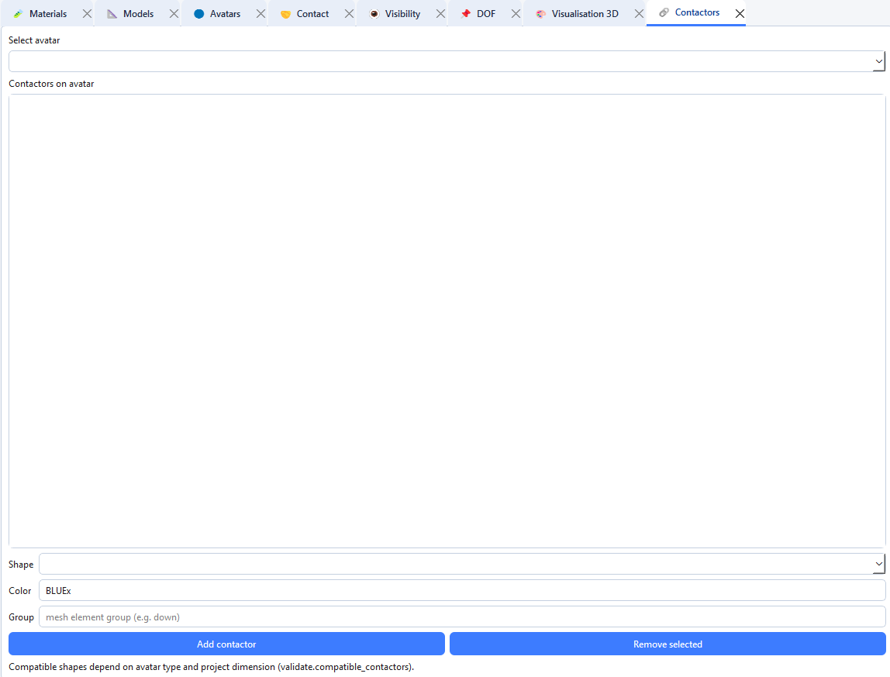

# Contactors

Contactors define contact geometry on an avatar (disk, polygon, sphere, plane, …).

## Add a contactor

1. Create or select the parent avatar.
2. Choose **shape** and **colour** (5-character LMGC90 code).
3. Fill shape **parameters** (e.g. `byrd` for DISKx, `vertices` for POLYG/POLYR, `High` for CYLND).
4. Validate.

Point contactors `PT2Dx` / `PT3Dx` need no parameters.

Then link colours/shapes in **Visibility** with a contact law.
