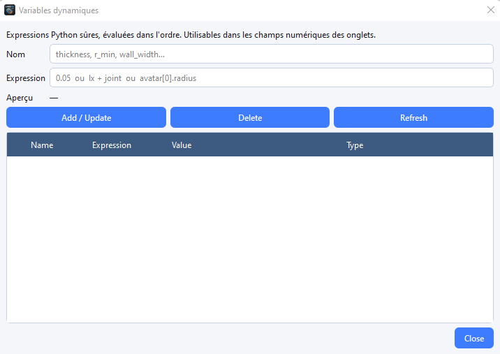

# Dynamic variables

Dynamic variables are named values you can reuse in numeric fields of the interface (thickness, scale, density, etc.).

## Define a variable

1. Open the dynamic variables dialog from the toolbar or the **Tools** menu.
2. Enter a **name** (identifier without spaces).
3. Enter a **value** (number or simple expression accepted by the application).
4. Validate.

## Use a variable

In a form field that accepts expressions, type the variable name. The value is substituted when the object is created or updated.

Variables are stored with the project. Rename or delete a variable only after checking that no form still depends on it.
