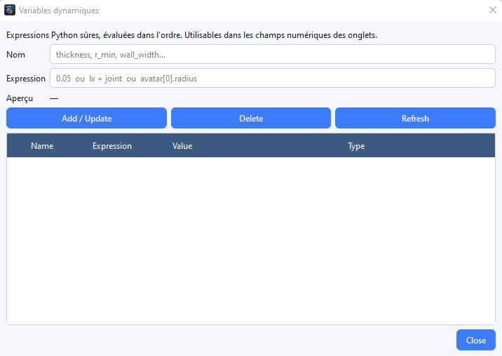

# Dynamic variables

Dynamic variables are named values you can reuse in numeric fields of the interface (thickness, scale, density, etc.).

## Define a variable

1. Open the dynamic variables dialog from the toolbar or the **Tools** menu.
2. Enter a **name** (identifier without spaces).
3. Enter a **value** (number or simple expression accepted by the application).
4. Validate.

## Use a variable

In a form field that accepts expressions, type the variable name. The value is substituted when the object is created or updated.

Variables are stored with the project. Rename or delete a variable only after checking that no form still depends on it.

## Supported expressions

Expressions use a restricted evaluator, not general Python. Available constants and functions include `pi`, `e`, `sqrt`, `sin`, `cos`, `tan`, `abs`, `min`, `max`, `round`, `sum`, `len`, `list`, `int`, `float`, `str` and `bool`. The project context also provides `dimension`, `n_bodies`, `avatar`, `group`, `material`, `model`, and `avatars_by_color`, `avatars_by_material`, `avatars_by_type`, and `avatars_by_origin`.

Call functions directly by name: `sin(angle)` is supported, but `math.sin(angle)` is not. NumPy is not exposed in this context, so `np.array(...)` is not a supported expression.

Examples:

| Expression | Example use |
|---|---|
| `sin(pi / 4) * radius` | A trigonometric expression using a project variable. |
| `sqrt(2)` | Square root. |
| `diameter / 2` | Derive a radius from a previously defined variable. |

Names already used by the evaluator or project context are reserved and cannot be defined as dynamic variables.
