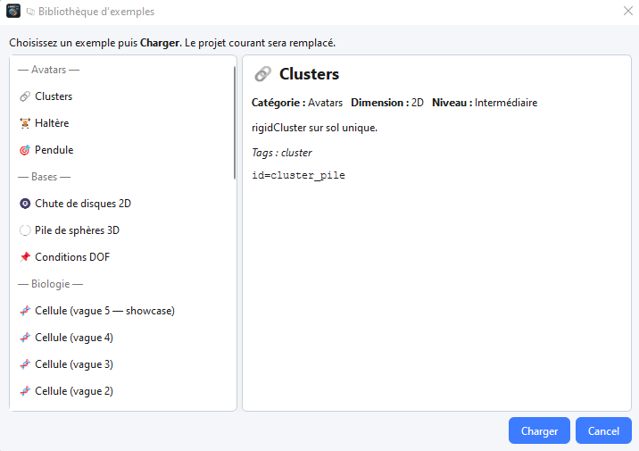

# Example library

The example library provides ready-made projects to load and explore.

## Load an example

1. Open the example library from the welcome flow or the dedicated menu/action.
2. Select an example compatible with the dimension you need.
3. Choose **replace** or **merge** behaviour when offered.
4. Save under your own path before modifying.

Examples illustrate materials, contactors, visibility and computation settings. After loading, review **Compute** parameters before running.

See [Create, open and organise a project](project_wizard.md).
