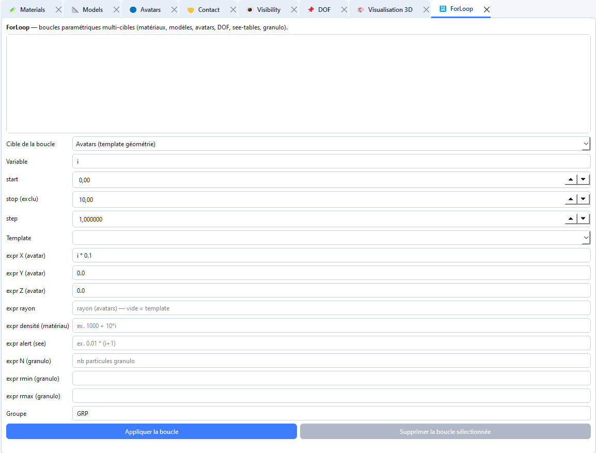

# Parametric ForLoop

The **ForLoop** tab builds parametric repetition of operations (copy along a path, repeated transforms).

1. Open **Tabs → Open → ForLoop** (`Ctrl+5`).
2. Set iteration range and source avatar(s) or group.
3. Set parametric law and **Add**.

Prefer groups for large patterns. Check the viewer after generation.
