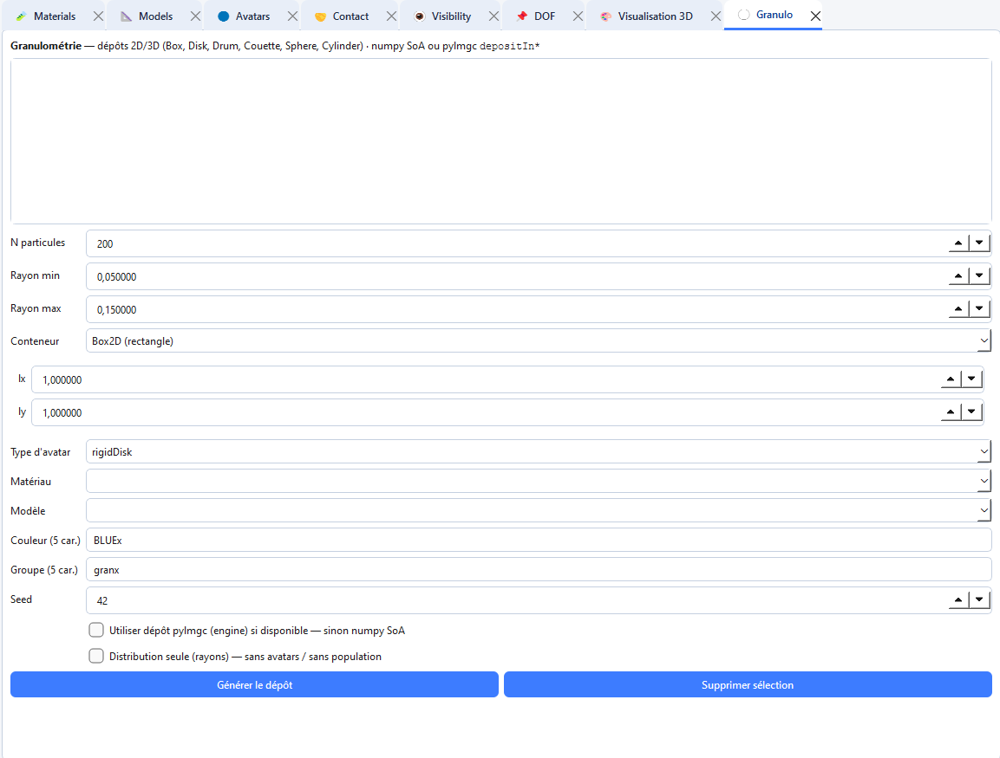

# Granulometry and populations

The **Granulo** tab generates particle populations from a size distribution and a container (box, disk, drum, Couette, …).

## Generate a population

1. Open **Tabs → Open → Granulo** (`Ctrl+6`).
2. Choose the container and its dimensions.
3. Set the granulometric law and size bounds.
4. Choose material and model for the grains.
5. Optionally assign a **group** name.
6. Generate and check the viewer.

Populations create many avatars at once. Save the project before large generations. Contact laws and visibility still need to be defined for the colours/shapes used by the grains and walls.

Technical details of population objects are also described in [Particle populations](particle_population.md).
