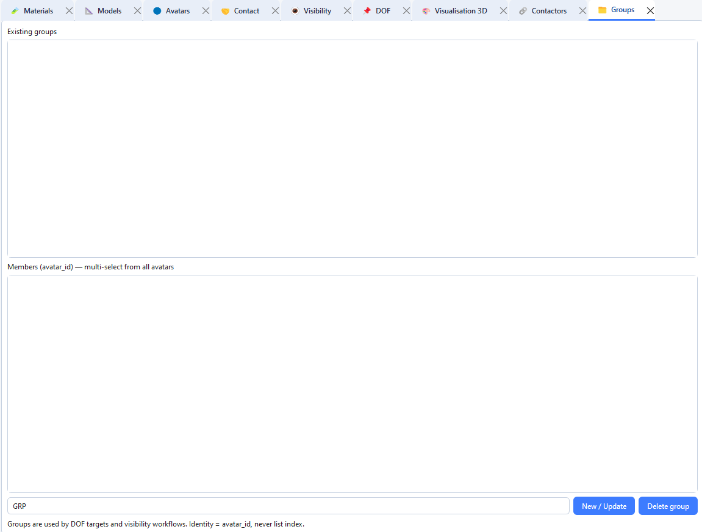

# Avatar groups

Groups gather avatars under a shared name so you can target them together in visibility tables, post-processing, DOF and computation options.

## Create a group

1. Open **Tabs → Open → Groups** (or the groups panel if available in your layout).
2. Enter a group **name**.
3. Select the avatars to include.
4. Validate.

## Use a group

- In **Visibility**, choose the group as candidate or antagonist when the UI offers a group target.
- In **Post-pro**, set **Target type** to `group`.
- In **Compute** / chipy routines, some extractions can be limited to a group.

An avatar may belong to several groups. Deleting a group does not delete its avatars.
