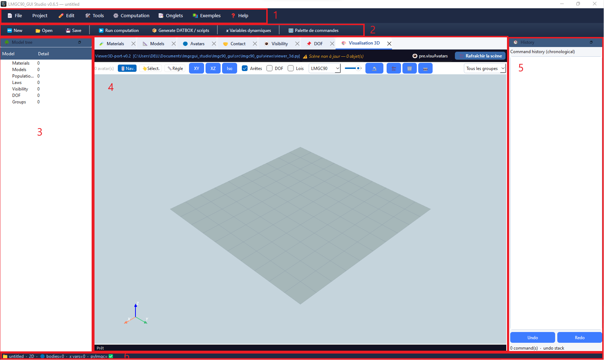
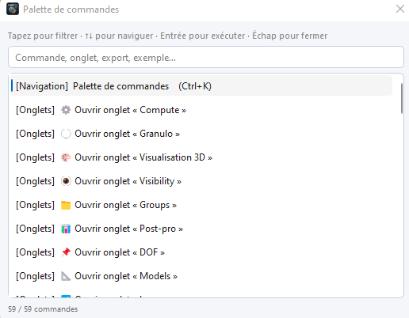
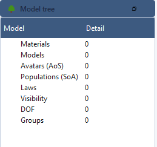
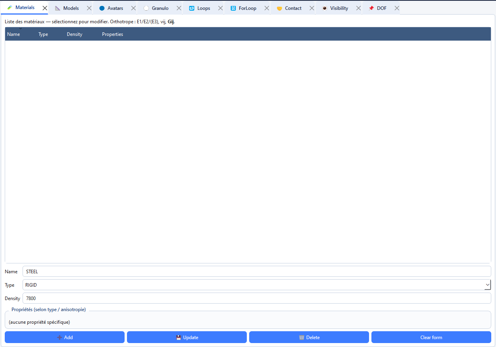
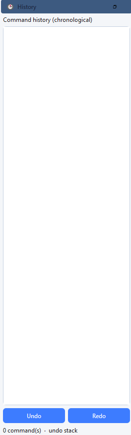
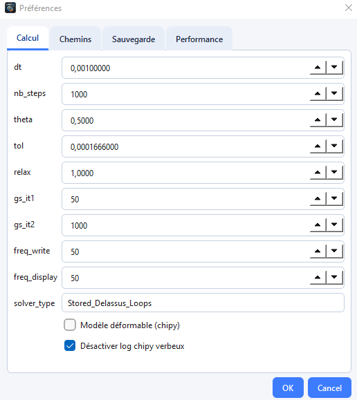

# Discover the graphical interface

LMGC90_GUI Studio is a modern graphical interface designed to make it easier to build numerical models with the **pre** (pre-processor) module of **LMGC90**.

You can also configure and run computations directly from LMGC90_GUI Studio through the **chipy** module.

The interface supports the full modelling workflow: creating elements, boundary conditions, post-processing, file generation and running computations.

## Main window

The interface is divided into **six main areas**:

1. **Menu**
2. **Toolbar** (top)
3. **Model tree** (left)
4. **Creation tabs** (centre)
5. **Command history** (right)
6. **Status bar** (bottom)

The **command palette** is available from the toolbar or with `Ctrl+K`.

## Menu (summary)

**File:** New (`Ctrl+N`), Open (`Ctrl+O`), Save (`Ctrl+S`), Save as (`Ctrl+Shift+S`), Quit (`Ctrl+Q`).

**Project:** Set dimension…

**Edit:** Undo (`Ctrl+Z`), Redo (`Ctrl+Y`).

**Tools:** Generate pre.py / command.py, Export all, Pipeline, Deformable wizard (`Ctrl+Shift+D`), Masonry wizard (`Ctrl+Shift+M`), Dynamic variables (`Ctrl+V`), visuAvatars, Preferences (`Ctrl+,`).

**Computation:** Run computation (`F5`).

**Tabs:** Open functional tabs; Default tabs (`Ctrl+Alt+D`). Shortcuts `Ctrl+1`…`Ctrl+9` for Materials through DOF.

## Toolbar, tree, tabs, history, status

## Preferences

**Tools → Preferences** (`Ctrl+,`): work directory, Python executable, default computation parameters, DATBOX options.

## Typical workflow

1. Create or open a project and set the dimension.
2. Create materials and models.
3. Create avatars (or Granulo / wizards).
4. Define contact laws and visibility.
5. Set DOF and groups.
6. Configure **Compute** and run.

See [index](overview.md) and [Prepare and run a computation](calculs.md).
