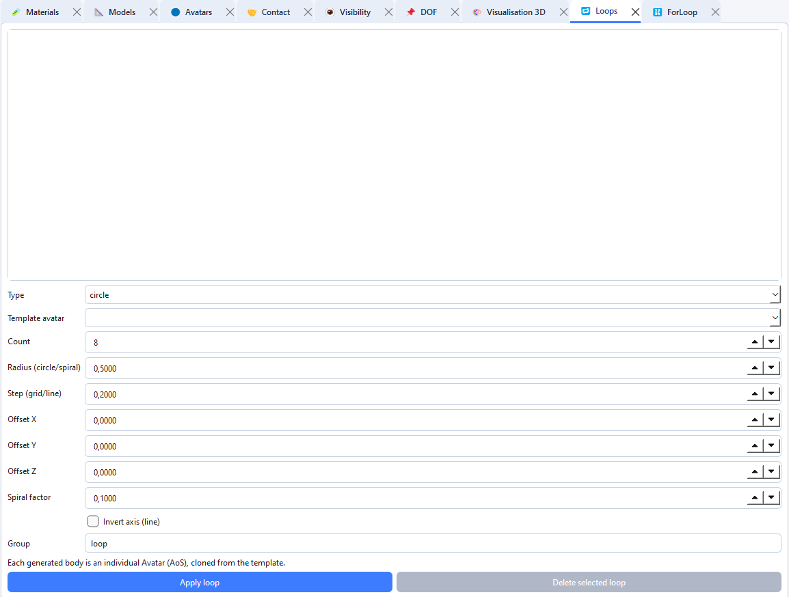

# Geometric loops

The **Loops** tab applies geometric transformations (translation, rotation, scaling) to one or more avatars, either once or repeatedly.

## Create a geometric loop

1. Open **Tabs → Open → Loops** (`Ctrl+4`).
2. Choose the transformation type.
3. Select the target avatars or a group.
4. Fill in the geometric parameters (vector, angle, centre, scale factors).
5. Set the number of repetitions if needed.
6. Click **Add**.

## Common uses

- Regular spacing of identical bodies
- Rotation of a set of contactors around a centre
- Scaling of a sub-assembly before contact definition

Loops modify the geometry already present in the scene. Save the project before applying a large number of transformations.
