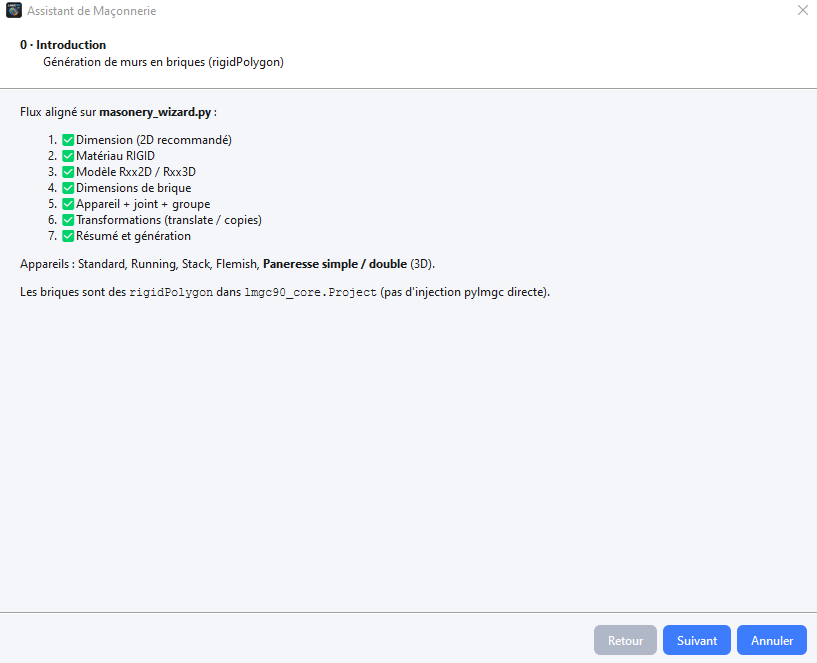

# Masonry wizard

**Tools → Masonry wizard…** (`Ctrl+Shift+M`) builds polygonal brick assemblies and can create group, contact law and visibility table.

Follow Introduction → Dimension → Material → Model → Brick size → Bond/layout → Transformations → Generate.

Patterns: Standard, Running Bond, Stack Bond, Flemish Bond, Paneresse (3D).

Review **Avatars**, **Contact** and **Visibility** before computing.
