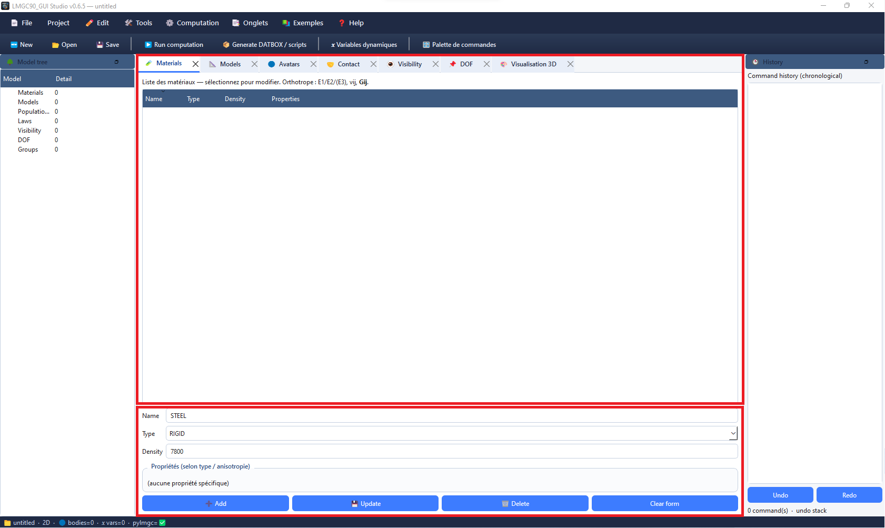

# Create a material

The **Materials** tab lists project materials and a create/edit form. Displayed properties change with the selected type.

Every tab has two sections: **List** and **Form**.

## Add a material

1. Open **Tabs → Open → Materials** (`Ctrl+1`).
2. Enter a **Name** (max five characters).
3. Choose **Type**.
4. Fill **Density** when enabled.
5. Complete **Properties (by type / anisotropy)**.
6. Click **Add**.
7. Select a row to **Update** or **Delete**.
8. **Clear form** prepares a new entry.

## Types

LMGC90_GUI Studio offers 10 types matching `pre.material(materialType=…)`: `RIGID`, `ELAS`, `ELAS_DILA`, `VISCO_ELAS`, `ELAS_PLAS`, `THERMO_ELAS`, `PORO_ELAS`, `DISCRETE`, `USER_MAT`, `EXTERNAL`.

Advanced types (`DISCRETE`, `USER_MAT`, `EXTERNAL`) have no automatic suggestions.

### Example: elastic steel

1. Choose `ELAS`, name `STEEL`.
2. Isotropic; Density ~`7850`, Young `2.1e11`, Poisson `0.3`.
3. **Add**, then assign to a model/avatar.

See [Dynamic variables](dynam_variables.md).
