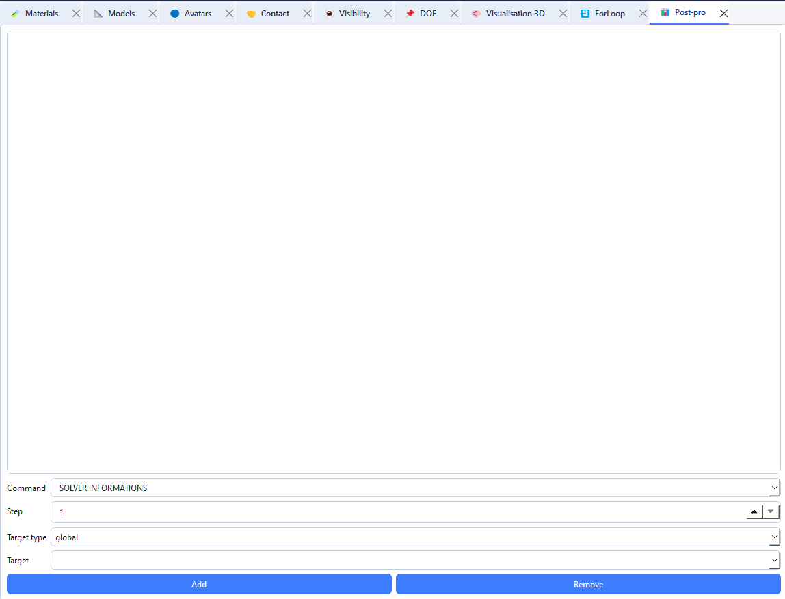

# Configure post-processing

The **Post-pro** tab adds extraction commands to the computation. It configures what the computation should write; it is not used to open or analyse result files after execution.

## Add a command

1. Open **Tabs → Open → Post-pro**.
2. Choose a **Command** value or type the name of a command accepted by your LMGC90 installation.
3. Set **Step**, the write frequency.
4. Choose **Target type**: `global`, `avatar` or `group`.
5. For an `avatar` target, select the avatar; for `group`, choose the group. For `global`, no target is required.
6. Click **Add**.
7. Check the command in the list.

## Edit or remove a command

1. Select a row in the list.
2. Change the fields and click **Update**, or click **Delete** to remove the command.
3. Click **Clear form** to start a new entry.

Post-processing commands are written into the generated computation script. After the run, use your usual LMGC90 tools to read the produced files.
