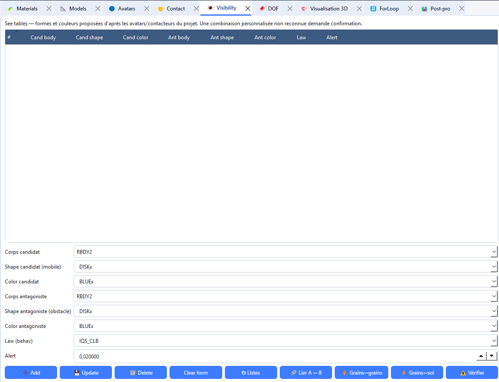

# Visibility tables

A visibility table links a candidate contactor to an antagonist and a contact law, with an **Alert** distance.

## Add a rule

1. Open **Tabs → Open → Visibility** (`Ctrl+8`).
2. Select candidate and antagonist (body, contactor, colour).
3. Choose the **contact law** and **Alert**.
4. Click **Add**. Use **Check** for missing references.

Without visibility rules, contactors do not interact even if laws exist.
