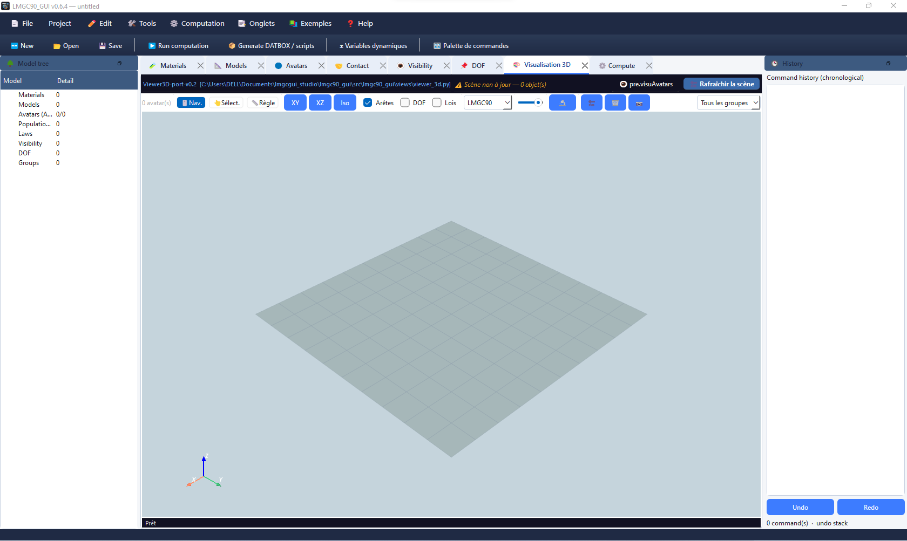

# Scene visualisation

LMGC90_GUI Studio provides a **built-in 3D viewer** (PyVista) and the native pylmgc90 **visuAvatars** viewer.

## Built-in viewer

1. Open **Tabs → Open → 3D Visualisation**.
2. Click **Refresh scene** after project changes.
3. Requires `pyvista` and `pyvistaqt`.

**Nav.** orbits/pans/zooms; **XY** / **XZ** / **Iso** preset views; **Select** and **Ruler** for picking and measuring.

Colour modes: LMGC90, by type, by material, by origin. Optional DOF and law annotations.

Visualisation is a modelling aid, not a substitute for result post-processing.
