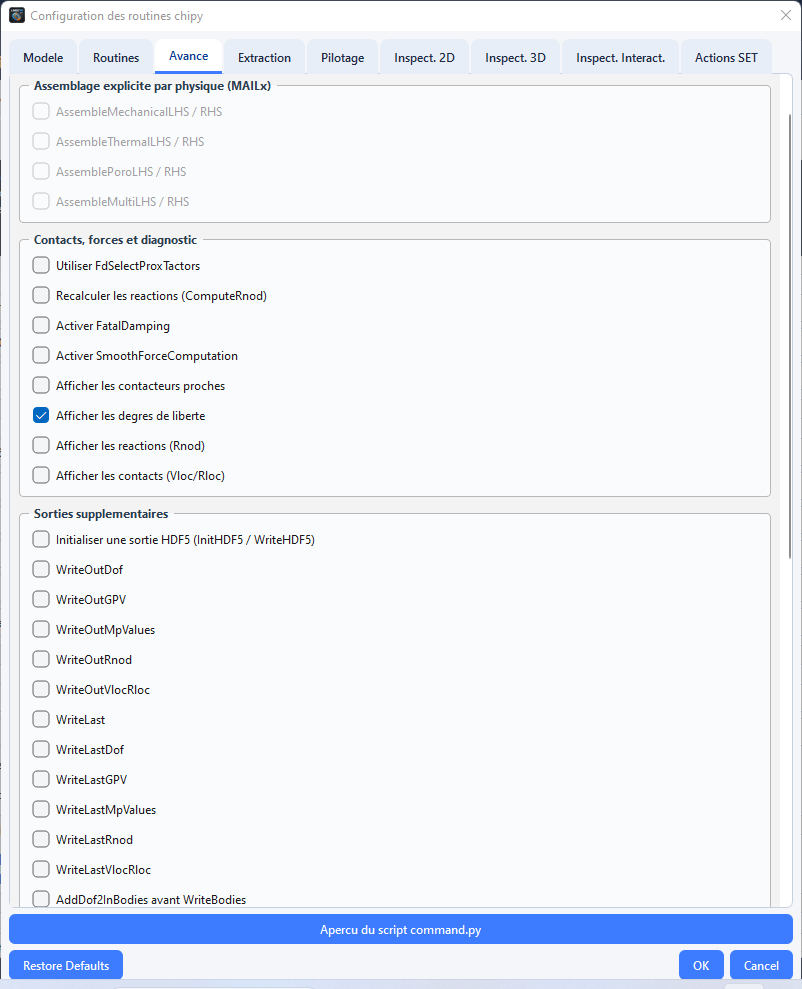
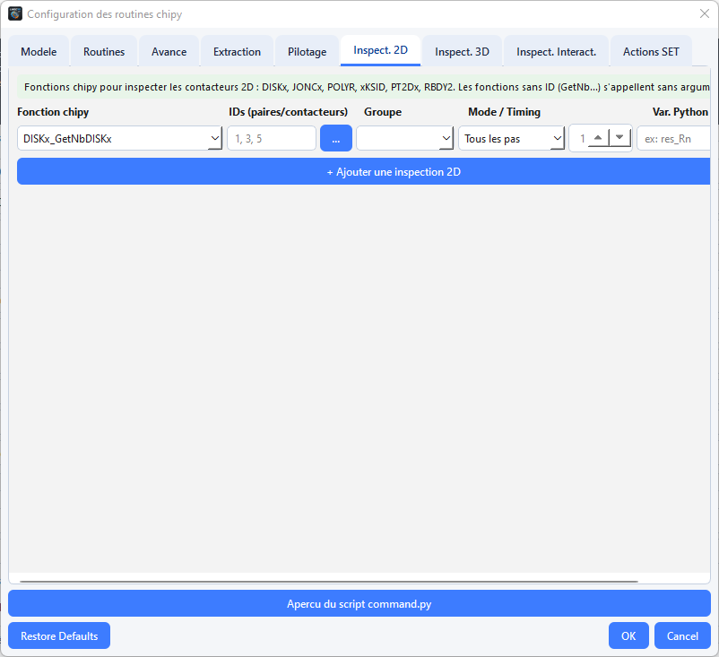
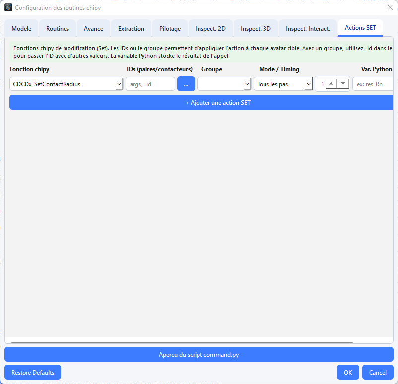

# Préparer et lancer un calcul

L’onglet **Compute** configure le script de calcul `command.py`, prépare le répertoire de travail et peut lancer le processus chipy. La disponibilité de _pylmgc90_ dans l’environnement qui exécute LMGC90_GUI Studio détermine les fonctions natives accessibles.


## Ouvrir l’onglet Compute

- Choisissez **Computation → Run computation** ouvre l'onglet **Compute** et lance le calcul.
- Le raccourci `F5` depuis la fenêtre principale ouvre également l’onglet et déclenche l’action de calcul.

L'onglet comprend de haut en bas : le **résumé du modèle**, les groupes **Paramètres temporels**, **Solveur de contact**, **Sorties**, **Routines chipy**, **Répertoire de calcul**, les boutons d'action, une ligne d'état et le **journal du calcul**.

## Régler les paramètres de base

### 1. Paramètres temporels
 
| Champ | Clé | Défaut | Description |
|---|---|---|---|
| **Pas de temps (dt)** | `dt` | `1e-3` | pas d'intégration (s) |
| **Nombre d'itérations** | `nb_steps` | `1000` | nombre de pas ; durée simulée = `dt × nb_steps` |
| **Theta intégrateur** | `theta` | `0.5` | paramètre du θ-schéma (`Integrator_InitTheta`) : 0,5 = Crank-Nicolson, 1 = Euler implicite |
 
Tous les champs sont des textes ; la **virgule décimale** est acceptée (`1e-3`, `0,5`). Les expressions et variables dynamiques ne le sont **pas** ici.
 
**Choisir `dt` (ordre de grandeur)** : le déplacement par pas doit rester petit devant le plus petit rayon (par exemple `v_max × dt ≲ 0,1 × r_min`) ; LMGC90 n'a pas de condition de stabilité liée à une raideur de contact, mais un `dt` trop grand dégrade la détection et la précision. Avec des corps déformables, tenez compte aussi des ondes élastiques. Commencez petit, puis augmentez.
 
### 2. Solveur de contact
 
| Champ | Clé | Défaut | Description |
|---|---|---|---|
| **Tolérance** | `tol` | `1.666e-4` | critère de convergence du solveur de contact |
| **Relaxation** | `relax` | `1.0` | facteur de relaxation |
| **Norme** | `norm` | `Quad ` | norme de convergence : `Quad ` · `QM   ` · `Maxim` (chaînes à 5 caractères, espaces compris) |
| **Itérations GS1** | `gs_it1` | `50` | paramètre d'itérations Gauss-Seidel (1ʳᵉ boucle) |
| **Itérations GS2** | `gs_it2` | `1000` | paramètre d'itérations Gauss-Seidel (2ᵉ boucle) |
| **Type de solveur** | `solver_type` | `Stored_Delassus_Loops` | `Stored_Delassus_Loops` · `Exchange_Local_Global` · `Conjugate_Gradient` |
 
Les chaînes `norm` et `solver_type` sont transmises **complétées par des espaces** (5 et 30 caractères) comme l'exige `chipy.ExSolver` : ne les modifiez pas à la main. Les sens exacts de la norme et de `gs_it1`/`gs_it2` sont définis par LMGC90 (consultez sa documentation) ; en pratique, augmenter les itérations améliore la convergence au prix du temps de calcul, et la bonne convergence se vérifie avec la commande de post-traitement `SOLVER INFORMATIONS`.
 
### 3. Sorties
 
| Champ | Clé | Défaut | Description |
|---|---|---|---|
| **Fréquence WriteOut** | `freq_write` | `50` | écriture des résultats tous les N pas (`chipy.WriteOut(freq)`) |
| **Fréquence Display** | `freq_display` | `50` | fichiers de visualisation tous les N pas (`WriteDisplayFiles(freq)`) |
| **Disable chipy log messages** | `disable_log` | coché | `chipy.utilities_DisableLogMes()` après l'initialisation |
| **ReadDatbox(deformable=True)** | `deformable` | selon projet | lecture des corps déformables |
 
Dossiers produits par un calcul (créés par `chipy.checkDirectories()`) : `OUTBOX/`, `DISPLAY/`, `POSTPRO/`. Ouvrez les fichiers de visualisation dans ParaView ; l'application ne propose pas d'explorateur de résultats.

**Remarque:** Les valeurs initiales de l’interface sont des paramètres de départ, pas une garantie de stabilité ou de convergence. Adaptez le pas de temps, le solveur et les fréquences à l’échelle du problème.

### 4. Boutons de l'onglet
 
| Bouton | Action |
|---|---|
| **📥 Charger préférences** | recharge dans le formulaire les valeurs enregistrées (dt, nb_steps, theta, tol, relax, gs_it1/2, norme, solveur, fréquences, déformable, log) et le répertoire de travail |
| **💾 Sauver → préférences** | enregistre ces valeurs et le répertoire dans `~/.LMGC90_GUI Studio/preferences.json` |
| **📦 Préparer DATBOX / scripts** | écrit `pre.py`, `command.py` et (si possible) `DATBOX/` |
| **▶ Lancer le calcul (F5)** | exécute `command.py` |
| **⏹ Stop** | demande l'arrêt du processus |


 
> Les réglages du **dialogue chipy** (routines, extraction, pilotage, inspection) **ne sont pas enregistrés** dans les préférences ni dans le projet : ils vivent en mémoire pendant la session de l'onglet. Après un redémarrage de l'application, il faut les saisir de nouveau.

### 5. Répertoire de calcul
 
Champ **Répertoire de calcul** + **Parcourir…**. Si le champ est vide au moment d'agir, une boîte de sélection s'ouvre. Il doit recevoir `command.py`, `pre.py` et `DATBOX/`. Le dernier répertoire choisi est mémorisé (préférences).

### 6. Préparer, puis lancer
 
#### Préparer (📦)
 
1. Les paramètres sont lus (message *« Paramètres invalides : … »* en cas d'erreur de saisie) et **enregistrés dans les préférences**.
2. Le répertoire est créé si besoin.
3. `pre.py` est écrit (toujours possible).
4. `command.py` est écrit avec **tous** les paramètres : formulaire **et** réglages chipy.
5. Si la préférence *DATBOX live si pylmgc90 disponible* est active (défaut) **et** que pylmgc90 est importable dans l'application : matérialisation puis écriture de `DATBOX/`.
6. Un message liste les fichiers écrits.
**Sans pylmgc90 dans l'application** : pas de DATBOX. Générez-la ensuite avec l'environnement qui possède pylmgc90 :
 
```bash
cd <répertoire_de_calcul>
python pre.py        # écrit DATBOX/ (pre.py se termine par pre.writeDatbox)
```
 
#### Lancer (▶ / F5)
 
1. Si `command.py` n'existe pas : proposition de **préparer maintenant**.
2. Si la préférence *Confirmer avant Run computation* est active (défaut) : confirmation affichant le répertoire et la commande `python command.py`.
3. Le journal de l'onglet se remplit ligne à ligne (sortie standard + erreurs fusionnées) ; le statut devient **Calcul en cours…**, puis **Terminé (rc=…)** ou **Échec**.
4. **⏹ Stop** envoie une demande d'arrêt (terminaison du processus).
Points importants :
 
- **Le lancement n'écrit pas `command.py` s'il existe déjà.** Si vous changez un paramètre, cliquez de nouveau sur **📦 Préparer DATBOX/scripts** avant **▶ Lancer le calcul**.
- Le lancement **ne vérifie pas** la présence de `DATBOX/`.
- L'interpréteur est celui de la préférence **Interpréteur Python** (défaut `python`, c'est-à-dire celui du `PATH`, pas forcément celui qui exécute `lmgc90-gui`). Il doit pouvoir `import pylmgc90`. Réglez-le dans **Tools → Preferences… → Chemins** (par exemple le `python` de l'environnement conda de pylmgc90).
- Le code retour `rc ≠ 0` indique une erreur : lisez la fin du journal (et `F7`).
### 7. Autres chemins de génération (attention aux différences)
 
| Chemin | Paramètres chipy utilisés | Remarque |
|---|---|---|
| **📦 Préparer DATBOX/scripts** (onglet Compute) | **formulaire + dialogue chipy** | le seul qui applique vos routines/extractions |
| **Computation → Generate DATBOX / scripts…** (`Ctrl+F5`) | préférences uniquement (dt, solveur, fréquences…) | écrit `pre.py`, `command.py`, DATBOX dans un dossier choisi ; **n'applique pas** le dialogue chipy |
| **Tools → Generate command.py…** | préférences uniquement | idem |
| **Tools → Export all…** | `dt = 1e-3`, `nb_steps = 5000` par défaut | n'utilise pas les préférences de calcul |
| **Tools → Pipeline / SLURM…** | préférences | A.14 |
 
Pour un calcul avec routines personnalisées : utilisez l'onglet **Compute → 📦 Préparer DATBOX/scripts**.

> Les détecteurs cochés doivent couvrir les types de contacteurs effectivement présents et les tables de visibilité du projet. Une table ne suffit pas si le détecteur correspondant n’est pas activé. 
---
### 8. Le dialogue « Configurer les routines chipy… »

Le dialogue s’ouvre depuis **Compute → Configurer les routines chipy…**. l pilote le contenu du script `command.py`, il comporte  9 onglets  :
| # | Onglet | 
|---|--------|
| 1 | Modèle | 
| 2 | Routines |
| 3 | **Avancé** |
| 4 | Extraction | 
| 5 | Pilotage | 
| 6 | Inspect. 2D | 
| 7 | Inspect. 3D | 
| 8 | Inspect. Interact. | 
| 9 | **Actions SET** | 

Boutons du bas :
 
| Bouton | Effet |
|---|---|
| **Aperçu du script command.py** | génère le script avec `dt=1e-3`, `nb_steps=100`, `freq_write=freq_display=10` et les options courantes ; affichage sombre, nombre de lignes indiqué. Sans projet chargé, un message l'indique. |
| **OK** | lance la  [validation](#89-validations-à-lacceptation-ok), puis ferme le dialogue |
| **Cancel** | ferme sans rien appliquer |
| **Restore Defaults** | demande confirmation, puis réinitialise toutes les options |
 
À chaque ouverture, une **auto-détection** s'applique depuis le projet

--- 
### 8.1 Onglet « Modèle »

#### 8.1.1 Auto-détection à l'ouverture
 
Les détecteurs de contact sont désormais **déduits des tables de visibilité** du projet (`infer_chipy_contact_routines`), et plus seulement de la dimension.
 
| Détection | Effet |
|---|---|
|Zone|	Contenu|
|Hypothèse mécanique|	`Contraintes planes (mhyp=1)`, `Déformations planes (mhyp=2)`, `Tridimensionnel (mhyp=0)`|
|Corps déformables|	case d’activation, **Physique MAILx** (`MECAx`, `THERx`, `POROx`, `MULTI)`, `Rloc_tol` (défaut `5e-2`)|
|Résumé|	nom, dimension, avatars (dont déformables), matériaux/modèles/lois, maçonnerie, lois actives, groupes|
 
Points à noter :

* Le 3D correspond à `mhyp` = 0 dans le dialogue. Le générateur force aussi `mhyp` = 0 quand le projet est 3D.
* En 3D, les boutons radio 2D (contraintes/déformations planes) sont désactivés.
* Cocher **déformables** déclenche `_on_phys_changed` :
    * `MECAx` coche `mecaMAILx` et `mecaMAILx_WriteDisplayFiles` ;
    * `THERx` coche `therMAILx` ;
    * `POROx` et `MULTI` cochent `poroMAILx`.


---
 
### 8.2 Onglet « Routines »
 
#### 8.2.1 Principe

La liste correspond désormais aux modules officiels de `chipy.macro.SelectProxTactors`. Les **contacteurs** (`DISKx`, `PT2Dx`, `SPHER`…) sont chargés par ``LoadTactors``. Ils ne se cochent pas ici : seuls les **détecteurs d’interaction** se cochent.

#### Corps rigides

|Case|	Effet|
|---|---------|
|``RBDY2``|	macros ``RBDY2_*`` (défaut ✅, actif seulement si le projet est 2D)|
|``RBDY3``|	macros ``RBDY3_*`` (actif seulement si le projet est 3D)|

#### Détecteurs 2D

|Détecteur|	Paire de contacteurs|	Usage|
|---|--------|----------|
|``CLALp``|	CLxxx / ALpxx	|ligne/ligne (maçonnerie, interfaces MAILx)|
|CLJCx``|	CLxxx / JONCx	|ligne/jonc|
| `CLJCx` | CLxxx / JONCx | ligne/jonc |
| `DKALp` | DISKx / ALpxx | disque/ligne MAILx |
| `DKDKL` | DISKx / DISKL | disque/disque linéaire |
| `DKDKx` | DISKx / DISKx | disque/disque (défaut ✅) |
| `DKJCx` | DISKx / JONCx | disque/jonc (murs) |
| `DKKDx` | DISKx / POLYG | disque/polygone |
| `DKPLx` | DISKx / PLANx | disque/plan |
| `P2P2L` | PT2DL / PT2DL | point/point linéaire |
| `PLALp` | PLANx / ALpxx | plan/ligne MAILx |
| `PLJCx` | PLANx / JONCx | plan/jonc |
| `PLPLx` | PLANx / PLANx | plan/plan (libellé du dialogue) |
| `PTPT2` | PT2Dx / PT2Dx | point/point (câbles, barres) |

#### Détecteurs 3D

|Détecteur|	Paire|	Usage|
|---|----|-----|
|`CDCDx`	|CYLND / CYLND|	cylindre/cylindre|
|`CDPLx`	|CYLND / PLANx	|cylindre/plan|
|`CSASp`	|CSxxx / ASpxx	|surface/surface MAILx|
|`CSPRx`	|CSxxx / POLYR	|surface/polyèdre|
|`PRASp`	|POLYR / ASpxx	|polyèdre/surface MAILx|
|`PRPLx`	|POLYR / PLANx	|polyèdre/plan|
|`PRPRx`	|POLYR / POLYR	|polyèdre/polyèdre|
|`PTPT3`	|PT3Dx / PT3Dx	|point/point 3D|
|`SPCDx`	|SPHER / CYLND	|sphère/cylindre|
|`SPDCx`	|SPHER / DNLYC	|sphère/cylindre creux|
|`SPPLx`	|SPHER / PLANx	|sphère/plan|
|`SPPRx`	|SPHER / POLYR	|sphère/polyèdre|
|`SPSPx`	|SPHER / SPHER	|sphère/sphère|

#### Macro globale

Utiliser `chipy.SelectProxTactors()` uniquement : voir [point d’attention](#812-démarche-recommandée).

#### Modules MAILx

`mecaMAILx`, `therMAILx`, `poroMAILx`, `multiMAILx` . Ils n’agissent que si « déformables » est coché.

#### Raccourcis (alias de compatibilité)

|Case|	Active en réalité|
|---|---------|
|Disque↔MAILx 2D (`use_DKMECAx)`)|	`DKALp`|
|CLALp maçonnerie↔MAILx (use_ALpMECAx``)|	`CLALp`|
|Sphère↔MAILx 3D (`use_SPMECAx`)|	`CSASp`|
|Update bulk behaviour	|`chipy.UpdateBulkBehav()`|


#### 8.2.2 Choisir ses détecteurs

Un détecteur doit exister pour **chaque paire** présente dans vos tables de visibilité. Le [tableau](#821-principe) donne la correspondance. Exemples :

| Paire (visibilité) | Détecteur |
|---|---|
| `DISKx` / `DISKx` | `DKDKx` |
| `DISKx` / `JONCx` | `DKJCx` |
| `SPHER` / `SPHER` | `SPSPx` |
| `SPHER` / `PLANx` | `SPPLx` |
| `PT3Dx` / `PT3Dx` (câbles, barres 3D) | `PTPT3` |
 
> **`POLYG` / `POLYG` (briques rigides 2D)** : la table interne `infer_chipy_contact_routines` associe cette paire à `DKKDx` (commentaire du code : *fallback*). Vérifiez dans la documentation LMGC90 si `PLPLx` convient mieux à votre cas, avant de lancer un calcul.

### 8.2.3 Auto-détection à l’ouverture

La fonction `infer_chipy_contact_routines(project)` (dans lmgc90_core) déduit les cases depuis :

1. les **avatars** et leurs contacteurs par défaut (par type d’avatar) ;
2. les **contacteurs explicite**s (`contactors`) ;
3. les **populations SoA**;
4. les **tables de visibilité**, avec la paire candidat/antagoniste → détecteur ;
5. les **contacteurs co-présents** dans la scène, même sans table ;
6. les **lois point/point** (`ELASTIC_WIRE`, `BRITTLE_ELASTIC_WIRE`, `ELASTIC_ROD`, `VOIGT_ROD`) → ``PTPT2`` (2D) ou `PTPT3` (3D) ;
7. la **présence d’un maillage** → `mecaMAILx` ;
8. des **défauts** si rien n’a été déduit : `DKDKx` (+ `DKJCx`) en 2D, `SPSPx` (+ `SPPLx`) en 3D.

Dans le dialogue :

* la dimension coche `RBDY2` ou `RBDY`` ;
* les détecteurs **déduits sont cochés** ;
* les détecteurs **spécifiques à l’autre dimension sont décochés**. C’est une amélioration par rapport à l’ancienne contrainte « 3D : décocher DKDKx à la main » ;
* un avatar `mesh` active « déformables » ;
* un avatar avec `wall_params` (maçonnerie) coche `CLALp`.

> L’auto-détection coche mais ne décoche que ce qui est propre à l’autre dimension : relisez le résultat à chaque ouverture.


 
 ---
### 8.3 Onglet « Avancé » (nouveau)
 
Il regroupe des appels **facultatifs**, ajoutés au script uniquement s'ils sont cochés. Les étapes indispensables (`Initialize`, `ReadDatbox`, `ComputeFreeVelocity`, `WriteOut`…) restent automatiques ; `ReadDatbox` lit déjà les fichiers DAT/INI.
 
#### 8.3.1 Assemblage explicite par physique (MAILx)
 
| Option | Appels générés (dans la boucle) | Disponible si |
|---|---|---|
| `advanced_assemble_mechanical` | `AssembleMechanicalLHS()` / `RHS()` | déformables + `mecaMAILx` |
| `advanced_assemble_thermal` | `AssembleThermalLHS()` / `RHS()` | déformables + `therMAILx` |
| `advanced_assemble_poro` | `AssemblePoroLHS()` / `RHS()` | déformables + `poroMAILx`, physique ≠ THM |
| `advanced_assemble_multi` | `AssembleMultiLHS()` / `RHS()` | déformables + physique **THMx** |
 
Les cases non pertinentes sont grisées.
 
#### 8.3.2 Contacts, forces et diagnostic
 
| Option | Effet |
|---|---|
| `FdSelectProxTactors` | remplace la sélection standard (réservé aux contacts SPHER/SPHER, voir [valisation](#89-validations-à-lacceptation-ok)) |
| `ComputeRnod` | `chipy.ComputeRnod()` après `UpdateStep` |
| `FatalDamping` | `RBDY2_FatalDamping()` / `RBDY3_FatalDamping()` juste après `IncrementStep` |
| `SmoothForceComputation` | après `UpdateTactBehav`, avant `StockRloc` |
| `DisplayProxTactors` | à chaque pas |
| `DisplayOutDof` | à chaque pas |
| `DisplayOutRnod` | à chaque pas |
| `DisplayOutVlocRloc` | à chaque pas |
 
#### 8.3.3 Sorties supplémentaires
 
**Dans la boucle** (avec la fréquence `freq_write`) :
 
| Option | Appel |
|---|---|
| HDF5 | `InitHDF5('<fichier>')` avant la boucle, puis `WriteHDF5()` à chaque pas |
| `write_out_dof` | `RBDY2_WriteOutDof(freq_write)` ou `RBDY3_WriteOutDof(freq_write)` selon la dimension |
| `write_out_gpv` | `WriteOutGPV(freq_write)` |
| `write_out_mp_values` | `WriteOutMpValues(freq_write)` |
| `write_out_rnod` | `WriteOutRnod(freq_write)` |
| `write_out_vloc_rloc` | `WriteOutVlocRloc(freq_write)` |
 
**Après la boucle** :
 
| Option | Appel |
|---|---|
| `write_last` | `WriteLast()` |
| `write_last_dof` | `WriteLastDof()` |
| `write_last_gpv` | `WriteLastGPV()` |
| `write_last_mp_values` | `WriteLastMpValues()` |
| `write_last_rnod` | `WriteLastRnod()` |
| `write_last_vloc_rloc` | `WriteLastVlocRloc()` |
| `write_bodies` | `WriteBodies()` (précédé de `AddDof2InBodies()` si `add_dof2`) |
| `write_behaviours` | `WriteBehaviours()` |
| `write_driven_dof` | `WriteDrivenDof()` |
| `write_mp_behaviours` | `WriteMpBehaviours()` |
 
#### 8.3.4 Affichage et post-traitement
 
| Option | Effet |
|---|---|
| `add_registers_to_display` | `chipy.addRegistersToDisplay()` avant `OpenDisplayFiles` |
| `circular_selection` | `chipy.CircularSelection(x, y, r)` après `ReadDatbox` (champ « Disque (x, y, r) », défaut `0.0, 0.0, 1.0`) |
 
#### 8.3.5 Réglages de contact (cases + champs d'arguments)
 
Chaque ligne se coche et reçoit ses **arguments Python** dans un champ texte :
 
| Case | Appel généré | Exemple d'arguments |
|---|---|---|
| `set_contact_radius` | `SetContactRadius(args)` | `0.01` |
| `set_domain_boundary` | `SetDomainBoundary(args)` | `Xmin=-1.0, Xmax=1.0` |
| `set_number_interaction` | `SetNumberInteractionByContact(args)` (*expérimental*) | `4` |
| `set_periodic_condition` | `SetPeriodicCondition(args)` | `xperiod=1.0` |
 
Ces appels sont émis juste après `ReadDatbox`. Le champ **Fichier HDF5** (défaut `command.h5`) se règle dans la même zone.



 ---

### 8.4 Onglet « Extraction »

Sections : logs, visualisation, visibilité, `GetBodyVector` RBDY2 et RBDY3, forces de contact, énergie, champs MAILx.
 
#### 8.4.1 Widget commun « Mode / Timing »
 
Visibilité, GBV et inspections partagent ce widget (liste + valeur) :
 
| Mode | Valeur | Code généré |
|---|---|---|
| Avant la boucle | `before` | appel unique avant `for k` |
| Tous les pas | `all` | à chaque itération |
| Tous les N pas | `every_n` (N ≥ 1) | `if k % N == 0:` |
| Au pas k = | `at_k` (k ≥ 0) | `if k == K:` |
| Après boucle | `after` | appel unique après la boucle |
 
- Le champ numérique n'est actif que pour `every_n` et `at_k`.
- `k` **commence à 0**.
- **Défauts** : *Avant la boucle* pour la visibilité ; *Tous les pas* pour GBV, inspections et actions SET.
- **Compatibilité** : un ancien projet sans `step_mode` est converti. `in_loop=False` donne `after`, `freq>1` donne `every_n`, et le reste donne `before` (visibilité) ou le défaut de la zone.
#### 8.4.2 Bouton « … » (sélecteur d'IDs)
 
Ouvre une liste d'avatars du projet à sélection multiple (Ctrl/Maj+clic). Il insère les numéros **1-based** (ordre de la liste des avatars) et pré-sélectionne les IDs déjà saisis. La liste est filtrée par dimension (2D ou 3D) ; `emptyAvatar` et `mesh` apparaissent dans les deux. Sans projet, un message l'indique.
 
#### 8.4.3 Résolution des IDs et des groupes
 
- **IDs prioritaires** sur le groupe si les deux sont renseignés.
- Un groupe est résolu en numéros `position + 1` dans `project.avatars`.
- Les **populations SoA** ne sont pas dans les groupes d'avatars. Leurs numéros commencent à `nb_avatars + 1`.
- Si un `avatar_id` du groupe est introuvable, un **avertissement** est journalisé (`F7`) et un **bandeau d'alerte** est ajouté avant `CloseDisplayFiles` dans `command.py`.
#### 8.4.4 Messages et visualisation
 
- `disable_log` : `utilities_DisableLogMes()` (la case de l'onglet **Compute** prime sur celle-ci).
- Visualisation : `visu_RBDY2` (✅), `visu_RBDY3`, `visu_mecaMAILx`, `visu_therMAILx`, `visu_poroMAILx`, `display_in_loop` (✅).
- Si `display_in_loop` est décoché : un seul `…_WriteDisplayFiles(1)` final, hors boucle.
#### 8.4.5 Visibilité des avatars (`SetVisible` / `SetInvisible`)
 
Chaque ligne : Action, Dim. (2D → `RBDY2`, 3D → `RBDY3`), IDs (+ « … »), Groupe, Mode/Timing. Appel : `chipy.RBDY2_SetVisible(id)` ou `chipy.RBDY2_SetInvisible(id)`.
 
#### 8.4.6 Extraction `RBDY2_GetBodyVector` / `RBDY3_GetBodyVector`
 
Vecteurs : `Coor0`, `Coor_`, `Coorb`, `Coorm`, `X____`, `V____`, `Vbeg_`, `Vfree`, `Fext`, `Fint_`, `Reac`, `Ireac`. Le générateur produit une boucle `for _id in [...]` appelant `chipy.RBDYx_GetBodyVector('<vec>', _id)`.


 
#### 8.4.7 Autres extractions
 
| Case | Appel |
|---|---|
| Forces nodales | `inter_handler_Rnod()` |
| Vitesses locales | `inter_handler_Vloc()` |
| Forces locales | `inter_handler_Rloc()` |
| Bilan énergétique | `ComputeEnergy()` + `WriteEnergy()` |
| Énergie cinétique | `RBDY2_KineticEnergy()` (2D, `RBDY2` actif) |
| Champs par élément | `mecaMAILx_WriteBodies(freq_write)` (exige `mecaMAILx`) |
| Variables internes | `mecaMAILx_WriteInternalVariables(freq_write)` (exige `mecaMAILx`) |

---
 
### 8.5 Onglet « Pilotage »
 
| Zone | Détail |
|---|---|
| **Restart** | génère `chipy.ReadIni(record=N)` après `ReadDatbox`, puis `OpenDisplayFiles(restart=N+1)` (n'agit que si `N ≠ 0`) |
| **Critère d'arrêt** | `energy` (`GetResidualEnergy`), `disp_max` (`GetMaxDisplacement`) ou `force_res` (`GetForceResidual`), évalué tous les `stop_freq` pas ; `break` si `critère < seuil` |
| **Multi-pas** | boucle externe sur `dt_sequence`, `steps_per_phase = nb_steps // nb_phases` ; le critère d'arrêt n'interrompt que la phase en cours |
 
Rappel : `import math` est ajouté au script si un critère d'arrêt est actif.


 
---

### 8.6 Onglets « Inspect. 2D », « Inspect. 3D », « Inspect. Interact. »
 
Les catalogues contiennent maintenant **plusieurs centaines de fonctions** chipy. Chaque ligne comporte :
 
| Colonne | Rôle |
|---|---|
| **Fonction chipy** | liste avec infobulle (description) |
| **IDs** + « … » | numéros de contacteurs (2D/3D) ou de paires (Interact., 1-based) ; **vide** pour les fonctions sans argument |
| **Groupe** | résolu en IDs si les IDs sont vides |
| **Mode / Timing** | voir [mode timing](#841-widget-commun--mode--timing-) |
| **Var. Python** | variable de stockage |
 
Contenu des catalogues :
 
- **2D** : `DISKx_*`, `JONCx_*`, `POLYG_*`, `xKSID_*`, `RBDY2_*` (très nombreuses : `GetAllMass`, `GetBodyVector`, `GetStress`, `GetVelocity`…), `PT2DL_*`, `PT2Dx_*`.
- **3D** : `SPHER_*`, `POLYR_*`, `CYLND_*`, `PLANx_*`, `DNLYC_*`, `RBDY3_*`, `PT3Dx_*`.
- **Interact.** : généralités (`GetDimension`, `TimeEvolution_Get*`), `DKDKx_GetCZMEnergy`, `PLPLx_GetCZMEnergy`, `PRPRx_Get*` (F2f, contraintes, vecteur d'interaction), `ALpxx` / `ASpxx` / `CLpxx` / `CSpxx` / `CSxxx` (connectivités et données), `MAILx_Get*`, `bulk_behav_Get*`, `postpro_*`, `tact_behav_Get*`, `therMAILx_Get*`, `poroMAILx_Get*`, `multiMAILx_Get*`, `mesh2D_GetIndicesMeshQ4`.
Règles du générateur :
 
- Fonction **sans ID** (nom contenant `GetNb`, nom dans `_NO_ID_FUNCS`, ou IDs et groupe vides) : appel sans argument, `res = chipy.DKDKx_GetNbDKDKx()`.
- Avec IDs : `for _id in [...]: chipy.<fonction>(_id)`.
- Le résultat est stocké dans `<variable>_{_id}` si une variable est donnée.
- Modes `before` et `after` : émis hors boucle.
- Le catalogue n'est **pas** filtré par version de chipy : vérifiez qu'une fonction existe dans la vôtre.
- Certaines fonctions marquées « 0 paramètre » dans le catalogue exigent en réalité un identifiant (`RBDY2_GetBodyVector`, `RBDY3_GetVelocity`…). Dans ce cas, renseignez les IDs malgré tout.



Les commandes de **post-traitement** (onglet Post-pro) sont écrites dans la DATBOX / `pre.py`, pas dans `command.py` ; voir [Post-traitement](postpro.md).

---

### 8.7 Onglet « Actions SET » (nouveau)
 
Il permet d'insérer un appel chipy de modification (`Set…`) à un instant choisi. Il réutilise le moteur de lignes des inspections.
 
- **Catalogue** : plusieurs centaines de fonctions `…_Set…` : `SetContactRadius`, `SetDimension`, `SetDomainBoundary`, `TimeEvolution_SetTimeStep`, `RBDY2_SetVisible` / `SetInvisible`, `RBDY3_SetXminBoundary`, `NewtonRaphson_Set*`, `nlgs_*`, `cpg_*`, `mecaMAILx_Set*`, `poroMAILx_Set*`, `tact_behav_Set*`, `postpro_Set*Zone`, etc.
- **Colonnes** : fonction, **arguments** (le champ « IDs » devient un champ d'arguments Python), groupe, mode/timing, variable.
- **Arguments** : expression Python valide, par exemple `dt * 0.5`, `1`, `Xmin=-1.0, Xmax=1.0`. Avec un groupe, utilisez `_id` dans les arguments.
- **Arity** : les valeurs numériques du catalogue suivent les signatures de `lmgc90_user_2025` ; `None` indique une fonction absente de cette version.
- **Timing attendu** (d'après `test_compute_script_set_actions.py`) :
| Mode | Code attendu |
|---|---|
| `before` | appel avant la boucle |
| `all` | `    chipy.SetThetaIntegrator(theta)` dans la boucle |
| `every_n` | `if k % 3 == 0:` puis appel indenté |
| `at_k` | `if k == 0:` puis appel indenté |
| `after` | appel après la boucle |
 
- Les erreurs de saisie attendues par les tests : `invalid Python arguments`, `valid chipy function name`, `invalid step mode`.

 
---
 
### 8.9 Validations à l'acceptation (**OK**)
 
| Contrôle | Message |
|---|---|
| Multi-pas : nombre de `dt` ≠ nombre de phases | « N phases déclarées mais M valeur(s) … » |
| Multi-pas : un `dt` ≤ 0 ou mal formé | « tous les dt doivent être > 0 » / « format invalide » |
| Déformables sans aucune routine MAILx | « aucune routine MAILx … cochée » |
| `Set…` avancé coché sans arguments | « indiquez les arguments requis » |
| Action SET : nom invalide (non identifiant, mot-clé Python, ou sans « Set ») | « indiquez un nom de fonction chipy valide contenant « Set » » |
| Action SET : arguments non analysables (`ast.parse`) | « arguments Python invalides » |
| HDF5 sans nom de fichier | « indiquez un nom de fichier » |
| HDF5 **et** `WriteOut*` ASCII individuels cochés | « HDF5 utilise WriteOut… décochez les sorties ASCII » |
| `AddDof2InBodies` sans `WriteBodies` | « cochez aussi WriteBodies » |
| `CircularSelection` sans arguments ou invalides | « indiquez les arguments (x, y, r) » / « arguments Python invalides » |
| `FdSelectProxTactors` si les visibilités ne sont pas **toutes** SPHER/SPHER (ou s'il n'y en a aucune) | « réservé aux projets dont tous les contacts sont SPHER/SPHER » |
 
En cas d'erreur, la boîte liste toutes les anomalies et le dialogue reste ouvert.

---
 
### 8.10 Préférences utiles (Tools → Preferences…)
 
| Onglet | Paramètres |
|---|---|
| **Calcul** | `dt`, `nb_steps`, `theta`, `tol`, `relax`, `gs_it1`, `gs_it2`, fréquences, `solver_type`, déformable, désactiver le log |
| **Chemins** | **Interpréteur Python**, dossier de travail, dossier projets, *DATBOX live si pylmgc90 disponible*, *Confirmer avant Run computation*, journal fichier, dimension par défaut, unités (métadonnée), langue |
 
### 8.11 Export SLURM (cluster)
 
**Tools → Pipeline / SLURM…**
 
| Champ | Défaut |
|---|---|
| Backend | `local` / `slurm` |
| Job name | nom du projet (≤ 40 car.) |
| Partition | `cpu` |
| Account | vide (`_SET_ME_` dans le script) |
| Time | `04:00:00` |
| ntasks / cpus-per-task | 1 / 1 |
| Memory | `8G` |
| Python | préférence interpréteur |
| Modules | `python/3.11` |
 
**Preview sbatch** affiche les étapes (`write_pre`, `write_chipy`, `write_datbox`, `run`) et le script ; **Export sbatch + scripts…** écrit dans un dossier : `pre.py`, `command.py`, `run.sbatch`, `pipeline.json` (et la DATBOX si possible). Le script lance `python pre.py` (construction de la DATBOX, pylmgc90 requis sur le nœud) puis `python command.py`. Le dialogue utilise les **préférences** (pas le dialogue chipy).
 
---
 
## 8.12 Démarche recommandée
 
1. Ouvrir le dialogue : l'auto-détection coche les détecteurs d'après vos visibilités.
2. Comparer avec le [](#821-principe), notamment les paires 3D hors `SPSPx`, `SPCDx`, `SPPLx`, `CDCDx`, `CDPLx`, `PRPRx` (voir [points d'attention](#813-points-dattention-relevés-dans-le-code)).
3. Régler Extraction / Pilotage / Avancé / SET si nécessaire.
4. **Aperçu du script**, puis lecture ciblée de la boucle.
5. **OK**, puis **📦 Préparer** dans l'onglet Compute.
6. Contrôler le `command.py` écrit avant **▶ Lancer**.
---

## 8.13 Points d'attention relevés dans le code
 
Écarts entre dialogue, générateur et tests (à corriger ou à signaler) :
 
1. **Macro `use_SelectProx_macro`** : lorsqu'elle est activée, les détecteurs individuels sont temporairement désactivés dans le dialogue et le script appelle `chipy.SelectProxTactors()` seul. Les sélections individuelles sont conservées si la macro est ensuite désactivée.
2. **Actions SET** : le dialogue produit `set_entries`, et `test_compute_script_set_actions.py` attend leur émission et des `ValueError` explicites. L'émission n'apparaît **pas** dans le `compute_script.py` fourni. Vérifiez que le générateur correspond à celui des tests.
3. **`multiMAILx`** : la case et la clé `use_multiMAILx` existent, mais le générateur ne produit aucun appel `multiMAILx_*`.
4. **Détecteurs 3D non émis** : le générateur ne lit, en 3D, que `SPSPx`, `SPCDx`, `SPPLx`, `CDCDx`, `CDPLx`, `PRPRx`. Les cases `CSASp`, `CSPRx`, `PRASp`, `PRPLx`, `SPDCx`, `SPPRx` sont cochables mais n'écrivent rien. `PTPT3` n'est émis que par le chemin `use_PT3Dx`, que le dialogue renseigne.
5. **Alias émis tels quels** : `use_DKMECAx`, `use_ALpMECAx`, `use_SPMECAx` sont conservés dans les paramètres en plus de leur détecteur réel. Le générateur peut donc émettre `chipy.DKMECAx_SelectProxTactors()` (nom absent de la liste officielle) en plus de `DKALp_…`.
6. **`PTPT2` dupliqué** : `PTPT2` est dans la liste 2D du générateur et ajouté une seconde fois par `use_PT2Dx` (dérivé de `use_PTPT2`). Vérifiez l'aperçu : l'appel peut apparaître deux fois.
7. **Textes d'aide obsolètes** :
   - la note de Pilotage cite `chipy.SetStep(restart_step)` alors que le code génère `ReadIni(record=N)` + `OpenDisplayFiles(restart=N+1)` ;
   - la note de l'onglet 2D cite `POLYR` pour les polygones 2D (le contacteur est `POLYG`) et `ALpALp`.
8. Les détecteurs 2D et 3D ainsi que leurs raccourcis sont grisés selon la dimension du modèle et l'activation de la macro globale.
9. **Résumé de l'onglet Compute** (`_update_chipy_summary`) : il liste encore `ALpALp`, `PT2Dx`, `PT3Dx` et `NODES`. À remplacer par la liste officielle.
10. **Liste `Norme`** : l'onglet Compute propose `Maxm `, tandis que `calculs.md` documente `Maxim`.
11. **Test d'intégration** : `test_chipy_script_enables_detectors_required_by_demo_visibility` attend `mhyp = 3`, `RBDY3_NewStep()` et `SetDimension(2)`, ce qui diffère de la sortie du générateur fourni (`mhyp = 0` en 3D, `SetDimension(dim, mhyp)`, boucle `IncrementStep`/`ComputeFreeVelocity`). Tests ou générateur sont à réaligner.
12. **Clés `chipy_options` d'anciennes préférences** : le dialogue ne reprend que les clés connues de `DEFAULTS` ; `use_mecaMAIL` / `use_therMAIL` / `use_poroMAIL` (anciens noms) sont migrées vers `…MAILx`.

---

### 8.14 Journaux
 
- **Onglet Compute** : sortie du processus.
- **Computation → Application journal** (`F7`) : événements internes (préparation, erreurs, repli de dépôt, avertissements de groupes).


La page [Post-traitement](postpro.md) décrit les commandes d’extraction ; la page [Visualisation](visualisation.md) décrit l’inspection de la scène avant calcul. L’application actuelle ne fournit pas un écran complet de parcours des fichiers de résultats calculés.
