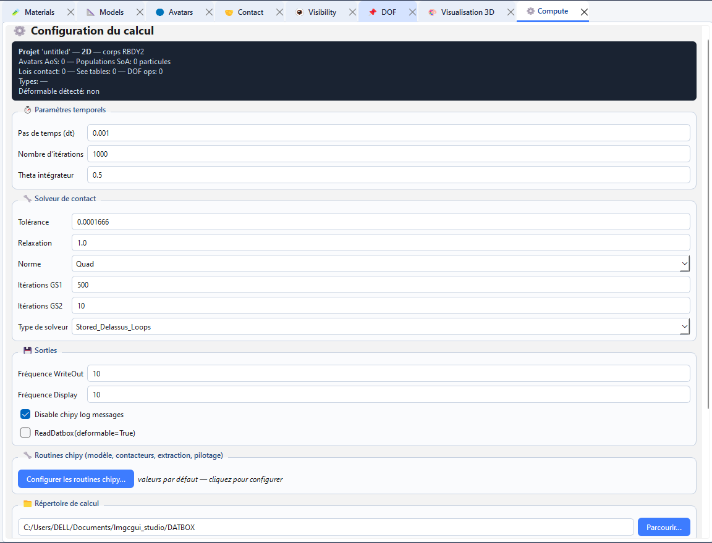
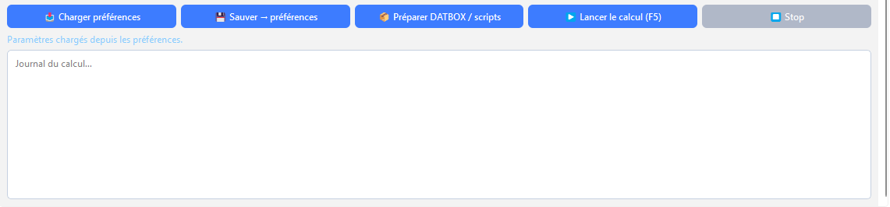
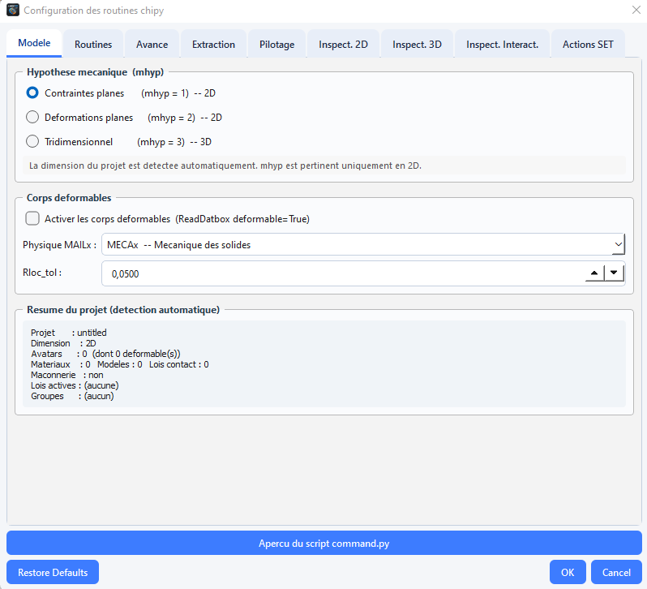
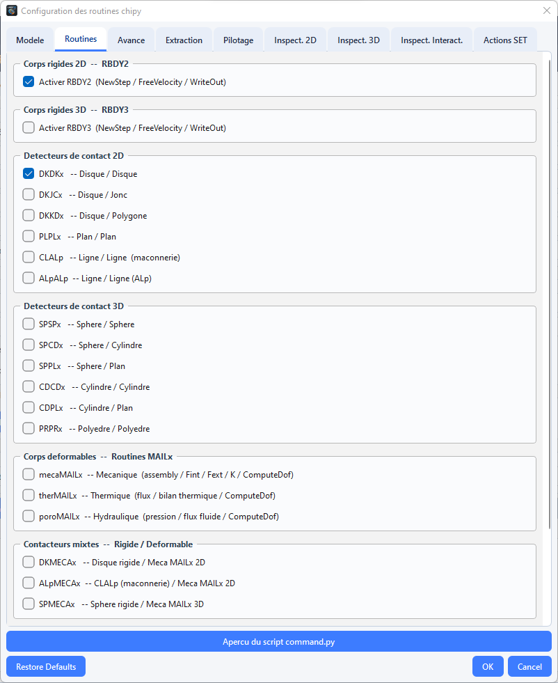
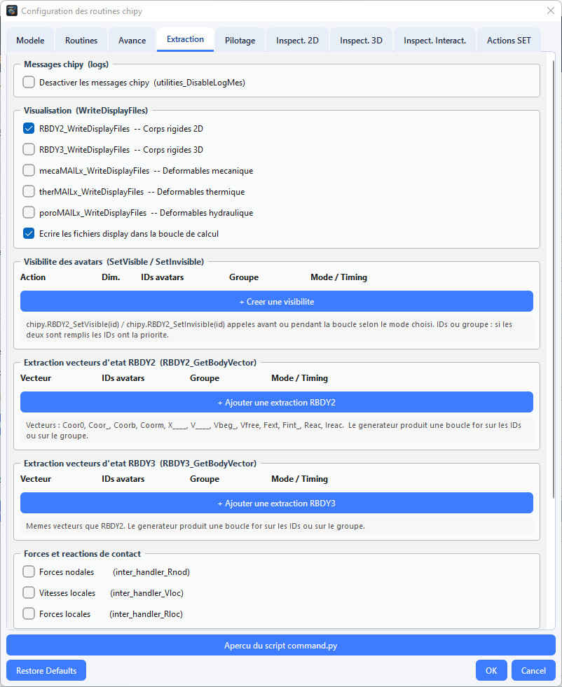
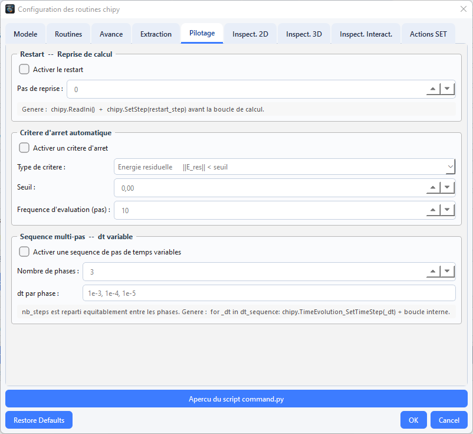

# Préparer et lancer un calcul

L’onglet **Compute** configure le script de calcul `command.py`, prépare le répertoire de travail et peut lancer le processus chipy. La disponibilité de pylmgc90 dans l’environnement qui exécute LMGC90_GUI Studio détermine les fonctions natives accessibles.



## Ouvrir l’onglet Compute

- Choisissez **Computation → Run computation** ouvre l'onglet **Compute** et lance le calcul.
- Le raccourci `F5` depuis la fenêtre principale ouvre également l’onglet et déclenche l’action de calcul.

L'onglet comprend de haut en bas : le **résumé du modèle**, les groupes **Paramètres temporels**, **Solveur de contact**, **Sorties**, **Routines chipy**, **Répertoire de calcul**, les boutons d'action, une ligne d'état et le **journal du calcul**.

## Régler les paramètres de base

### 1. Paramètres temporels
 
| Champ | Clé | Défaut | Description |
|---|---|---|---|
| **Pas de temps (dt)** | `dt` | `1e-3` | pas d'intégration (s) |
| **Nombre d'itérations** | `nb_steps` | `1000` | nombre de pas ; durée simulée = `dt × nb_steps` |
| **Theta intégrateur** | `theta` | `0.5` | paramètre du θ-schéma (`Integrator_InitTheta`) : 0,5 = Crank-Nicolson, 1 = Euler implicite |
 
Tous les champs sont des textes ; la **virgule décimale** est acceptée (`1e-3`, `0,5`). Les expressions et variables dynamiques ne le sont **pas** ici.
 
**Choisir `dt` (ordre de grandeur)** : le déplacement par pas doit rester petit devant le plus petit rayon (par exemple `v_max × dt ≲ 0,1 × r_min`) ; LMGC90 (non lissé) n'a pas de condition de stabilité liée à une raideur de contact, mais un `dt` trop grand dégrade la détection et la précision. Avec des corps déformables, tenez compte aussi des ondes élastiques. Commencez petit, puis augmentez.
 
### 2. Solveur de contact
 
| Champ | Clé | Défaut | Description |
|---|---|---|---|
| **Tolérance** | `tol` | `1.666e-4` | critère de convergence du solveur de contact |
| **Relaxation** | `relax` | `1.0` | facteur de relaxation |
| **Norme** | `norm` | `Quad ` | norme de convergence : `Quad ` · `QM   ` · `Maxim` (chaînes à 5 caractères, espaces compris) |
| **Itérations GS1** | `gs_it1` | `50` | paramètre d'itérations Gauss-Seidel (1ʳᵉ boucle) |
| **Itérations GS2** | `gs_it2` | `1000` | paramètre d'itérations Gauss-Seidel (2ᵉ boucle) |
| **Type de solveur** | `solver_type` | `Stored_Delassus_Loops` | `Stored_Delassus_Loops` · `Exchange_Local_Global` · `Conjugate_Gradient` |
 
Les chaînes `norm` et `solver_type` sont transmises **complétées par des espaces** (5 et 30 caractères) comme l'exige `chipy.ExSolver` : ne les modifiez pas à la main. Les sens exacts de la norme et de `gs_it1`/`gs_it2` sont définis par LMGC90 (consultez sa documentation) ; en pratique, augmenter les itérations améliore la convergence au prix du temps de calcul, et la bonne convergence se vérifie avec la commande de post-traitement `SOLVER INFORMATIONS`.
 
### 3. Sorties
 
| Champ | Clé | Défaut | Description |
|---|---|---|---|
| **Fréquence WriteOut** | `freq_write` | `50` | écriture des résultats tous les N pas (`chipy.WriteOut(freq)`) |
| **Fréquence Display** | `freq_display` | `50` | fichiers de visualisation tous les N pas (`WriteDisplayFiles(freq)`) |
| **Disable chipy log messages** | `disable_log` | coché | `chipy.utilities_DisableLogMes()` après l'initialisation |
| **ReadDatbox(deformable=True)** | `deformable` | selon projet | lecture des corps déformables |
 
Dossiers produits par un calcul (créés par `chipy.checkDirectories()`) : `OUTBOX/`, `DISPLAY/`, `POSTPRO/`. Ouvrez les fichiers de visualisation dans ParaView ; l'application ne propose pas d'explorateur de résultats.

**Remarque:** Les valeurs initiales de l’interface sont des paramètres de départ, pas une garantie de stabilité ou de convergence. Adaptez le pas de temps, le solveur et les fréquences à l’échelle du problème.

### 4. Boutons de l'onglet
 
| Bouton | Action |
|---|---|
| **📥 Charger préférences** | recharge dans le formulaire les valeurs enregistrées (dt, nb_steps, theta, tol, relax, gs_it1/2, norme, solveur, fréquences, déformable, log) et le répertoire de travail |
| **💾 Sauver → préférences** | enregistre ces valeurs et le répertoire dans `~/.LMGC90_GUI Studio/preferences.json` |
| **📦 Préparer DATBOX / scripts** | écrit `pre.py`, `command.py` et (si possible) `DATBOX/` |
| **▶ Lancer le calcul (F5)** | exécute `command.py` |
| **⏹ Stop** | demande l'arrêt du processus |


 
> Les réglages du **dialogue chipy** (routines, extraction, pilotage, inspection) **ne sont pas enregistrés** dans les préférences ni dans le projet : ils vivent en mémoire pendant la session de l'onglet. Après un redémarrage de l'application, il faut les saisir de nouveau.

## 5. Répertoire de calcul
 
Champ **Répertoire de calcul** + **Parcourir…**. Si le champ est vide au moment d'agir, une boîte de sélection s'ouvre. Il doit recevoir `command.py`, `pre.py` et `DATBOX/`. Le dernier répertoire choisi est mémorisé (préférences).

### 6. Préparer, puis lancer
 
#### Préparer (📦)
 
1. Les paramètres sont lus (message *« Paramètres invalides : … »* en cas d'erreur de saisie) et **enregistrés dans les préférences**.
2. Le répertoire est créé si besoin.
3. `pre.py` est écrit (toujours possible).
4. `command.py` est écrit avec **tous** les paramètres : formulaire **et** réglages chipy.
5. Si la préférence *DATBOX live si pylmgc90 disponible* est active (défaut) **et** que pylmgc90 est importable dans l'application : matérialisation puis écriture de `DATBOX/`.
6. Un message liste les fichiers écrits.
**Sans pylmgc90 dans l'application** : pas de DATBOX. Générez-la ensuite avec l'environnement qui possède pylmgc90 :
 
```bash
cd <répertoire_de_calcul>
python pre.py        # écrit DATBOX/ (pre.py se termine par pre.writeDatbox)
```
 
#### Lancer (▶ / F5)
 
1. Si `command.py` n'existe pas : proposition de **préparer maintenant**.
2. Si la préférence *Confirmer avant Run computation* est active (défaut) : confirmation affichant le répertoire et la commande `python command.py`.
3. Le journal de l'onglet se remplit ligne à ligne (sortie standard + erreurs fusionnées) ; le statut devient **Calcul en cours…**, puis **Terminé (rc=…)** ou **Échec**.
4. **⏹ Stop** envoie une demande d'arrêt (terminaison du processus).
Points importants :
 
- **Le lancement n'écrit pas `command.py` s'il existe déjà.** Si vous changez un paramètre, cliquez de nouveau sur **📦 Préparer** avant **▶**.
- Le lancement **ne vérifie pas** la présence de `DATBOX/`.
- L'interpréteur est celui de la préférence **Interpréteur Python** (défaut `python`, c'est-à-dire celui du `PATH`, pas forcément celui qui exécute `lmgc90-gui`). Il doit pouvoir `import pylmgc90`. Réglez-le dans **Tools → Preferences… → Chemins** (par exemple le `python` de l'environnement conda de pylmgc90).
- Le code retour `rc ≠ 0` indique une erreur : lisez la fin du journal (et `F7`).
### 7. Autres chemins de génération (attention aux différences)
 
| Chemin | Paramètres chipy utilisés | Remarque |
|---|---|---|
| **📦 Préparer** (onglet Compute) | **formulaire + dialogue chipy** | le seul qui applique vos routines/extractions |
| **Computation → Generate DATBOX / scripts…** (`Ctrl+F5`) | préférences uniquement (dt, solveur, fréquences…) | écrit `pre.py`, `command.py`, DATBOX dans un dossier choisi ; **n'applique pas** le dialogue chipy |
| **Tools → Generate command.py…** | préférences uniquement | idem |
| **Tools → Export all…** | `dt = 1e-3`, `nb_steps = 5000` par défaut | n'utilise pas les préférences de calcul |
| **Tools → Pipeline / SLURM…** | préférences | A.14 |
 
Pour un calcul avec routines personnalisées : utilisez l'onglet **Compute → Préparer**.


Les détecteurs cochés doivent couvrir les types de contacteurs effectivement présents et les tables de visibilité du projet. Une table ne suffit pas si le détecteur correspondant n’est pas activé.

### 8. Le dialogue « Configurer les routines chipy… »

Ouvert depuis l'onglet Compute. Boutons : **Aperçu du script command.py** (génère le script dans une fenêtre sombre, avec des valeurs numériques indicatives), **OK**, **Cancel**, **Restore Defaults**. `OK` valide :
 
- multi-pas : nombre de `dt` = nombre de phases, tous > 0 ;
- corps déformables activés ⇒ au moins une routine FEM cochée.
À chaque ouverture, une **auto-détection** s'applique (A.11.1). Le résumé sous le bouton dans l'onglet Compute affiche : déformable (+ physique), `mhyp`, détecteurs cochés (5 premiers), corps `RBDY2/RBDY3`, restart / critère d'arrêt / multi-pas.
 
#### 8.1 Auto-détection à l'ouverture
 
| Détection | Effet |
|---|---|
| dimension 3 | radio « Tridimensionnel » ; `RBDY3` coché, `RBDY2` décoché ; sinon contraintes planes, `RBDY2` coché, `RBDY3` décoché |
| avatar `mesh` | « corps déformables » coché + routines FEM selon la physique |
| avatar avec paramètres de mur (briques) | `CLALp` coché |
| lois `ELASTIC_WIRE`, `BRITTLE_ELASTIC_WIRE`, `ELASTIC_ROD`, `VOIGT_ROD` | `PT2Dx` (2D) / `PT3Dx` (3D) coché |
| lois `COUPLED_DOF`, `NORMAL_COUPLED_DOF` | `NODES` coché |
 
L'auto-détection **coche** (elle ne décoche pas, hors `RBDY2/RBDY3`) : vérifiez chaque ouverture que le résultat vous convient.
 
#### 8.2 Onglet « Modèle »
 
| Zone | Contenu |
|---|---|
| **Hypothèse mécanique `mhyp`** | `1` contraintes planes · `2` déformations planes (2D) · `3` tridimensionnel |
| **Corps déformables** | case *Activer les corps déformables* (`ReadDatbox(deformable=True)`) ; **Physique FEM** : `MECAx`, `THERx`, `POROx`, `THMx` ; **`Rloc_tol`** (défaut `5e-2`, tolérance de reprise des efforts de contact) |
| **Résumé du projet** | nom, dimension, avatars (dont déformables), matériaux/modèles/lois, maçonnerie, lois actives, groupes |
 
Cocher « déformables » coche automatiquement les routines selon la physique (`MECAx` → `mecaMAILx` ; `THERx` → `therMAILx` ; `PORORx` → `poroMAILx`) et les fichiers de visualisation correspondants.


 
#### 8.3 Onglet « Routines »
 
| Groupe | Cases (clé) | Remarques |
|---|---|---|
| Corps rigides 2D | `RBDY2` (`use_RBDY2`, défaut ✅) | actif seulement si le projet est 2D |
| Corps rigides 3D | `RBDY3` (`use_RBDY3`) | actif seulement si 3D |
| Détecteurs 2D | `DKDKx` (✅ par défaut), `DKJCx`, `DKKDx`, `PLPLx`, `CLALp`, `ALpALp` | libellés du dialogue : disque/disque, disque/jonc, disque/polygone, plan/plan, ligne/ligne (maçonnerie), ALp/ALp |
| Détecteurs 3D | `SPSPx`, `SPCDx`, `SPPLx`, `CDCDx`, `CDPLx`, `PRPRx` | sphère/sphère, sphère/cylindre, sphère/plan, cylindre/cylindre, cylindre/plan, polyèdre/polyèdre |
| FEM | `mecaMAILx`, `therMAILx`, `poroMAILx` | n'agissent que si « déformables » est coché |
| Mixtes rigide/déformable | `DKMECAx`, `ALpMECAx`, `SPMECAx` | disque/MECAx 2D, ALp/MECAx 2D, sphère/MECAx 3D |
| Spéciales | `PT2Dx`, `PT3Dx`, `NODES`, `UpdateBulkBehav` | liaisons point/point, couplage de DDL, lois volumiques (plasticité, endommagement) |
 
**Choisir les détecteurs** : un détecteur doit exister pour **chaque** paire de contacteurs apparaissant dans vos tables de visibilité. Repères (à recouper avec la documentation LMGC90) :
 
| Paire de contacteurs (visibilité) | Détecteur |
|---|---|
| `DISKx` / `DISKx` | `DKDKx` |
| `DISKx` / `JONCx` | `DKJCx` |
| `POLYG` / `POLYG` (briques rigides 2D) | `PLPLx` |
| `SPHER` / `SPHER` | `SPSPx` |
| `SPHER` / `PLANx` | `SPPLx` |
| `SPHER` / `CYLND` | `SPCDx` |
| `CYLND` / `CYLND` · `CYLND` / `PLANx` | `CDCDx` · `CDPLx` |
| `POLYR` / `POLYR` | `PRPRx` |
| rigide / maillé | `DKMECAx`, `ALpMECAx`, `SPMECAx` selon la paire |
| `PT2Dx`/`PT3Dx` (câbles, barres) | `PT2Dx`, `PT3Dx` |


 
> **Projet 3D : décocher les détecteurs 2D.** `DKDKx` est coché par défaut. En 3D, les cases 2D sont grisées mais restent cochées et seraient émises dans `command.py`. Pour les décocher : choisissez provisoirement « Contraintes planes » (qui réactive les cases 2D), décochez `DKDKx`, puis revenez à « Tridimensionnel ». Vérifiez avec **Aperçu du script**.
 
#### 8.4 Onglet « Extraction »
 
**1. Messages chipy** — `Désactiver les messages chipy` (`disable_log`, `utilities_DisableLogMes`). La case de l'onglet **Compute** (cochée par défaut) **prime** sur celle-ci.
 
**2. Visualisation** — `visu_RBDY2` (✅), `visu_RBDY3`, `visu_mecaMAILx`, `visu_therMAILx`, `visu_poroMAILx` ; `display_in_loop` (✅) : fichiers d'affichage écrits dans la boucle (sinon une fois à la fin).
 
**3. Visibilité des avatars (`SetVisible` / `SetInvisible`)** — bouton *+ Créer une visibilité*. Chaque ligne :
 
| Colonne | Contenu |
|---|---|
| Action | `SetVisible` ou `SetInvisible` |
| Dim. | `2D` (`RBDY2`) ou `3D` (`RBDY3`) |
| IDs avatars | numéros de corps (voir ci-dessous) ; bouton **…** pour les choisir dans la liste du projet |
| Groupe | groupe d'avatars (résolu en numéros) |
| Mode / Timing | A.11.7 (défaut *Avant la boucle*) |


 
**4. Vecteurs d'état `RBDY2_GetBodyVector` / `RBDY3_GetBodyVector`** — boutons *+ Ajouter une extraction RBDY2/RBDY3*. Chaque ligne : **Vecteur** (`Coor0` position initiale · `Coor_` courante · `Coorb` début de pas · `Coorm` milieu de pas · `X____` coordonnées généralisées · `V____` vitesses · `Vbeg_` vitesses début de pas · `Vfree` vitesses libres · `Fext` forces extérieures · `Fint_` forces intérieures · `Reac` réactions · `Ireac` impulsions), IDs, groupe, timing (défaut *Tous les pas*).
 
**5. Forces et réactions de contact** — `inter_handler_Rnod` (forces nodales), `inter_handler_Vloc` (vitesses locales), `inter_handler_Rloc` (forces locales).
 
**6. Énergie** — bilan global (`ComputeEnergy` + `WriteEnergy`) ; énergie cinétique `RBDY2_KineticEnergy` (2D).
 
**7. Champs FEM** — `mecaFEMx_WriteBodies(freq_write)` (champs par élément), `mecaFEMx_WriteInternalVariables(freq_write)` (variables internes) ; ces deux options exigent `mecaFEMx`.
 
> **Numéros de corps (IDs).** Les « IDs avatars » sont les numéros **1, 2, 3…** dans l'ordre de la liste des avatars du projet (le sélecteur **…** les affiche). Les particules de populations SoA sont écrites **après** les avatars dans `pre.py` : leurs numéros sont `nombre_d_avatars + 1…`. Les **groupes** ne résolvent que les avatars individuels. Si un identifiant de groupe est introuvable, un avertissement est journalisé et un bandeau d'alerte est ajouté à la fin de `command.py`.
 
#### 8.5 Onglet « Pilotage »
 
| Zone | Champs | Effet généré |
|---|---|---|
| **Restart** | case ; *Pas de reprise* | `chipy.ReadIni()` puis `chipy.SetStep(pas)` avant la boucle |
| **Critère d'arrêt** | type (*Énergie résiduelle* · *Déplacement max* · *Résidu de force*), seuil (défaut `1e-6`), fréquence d'évaluation (défaut 10) | test périodique dans la boucle puis `break` si `critère < seuil` |
| **Multi-pas** | nombre de phases (2 à 20), `dt` par phase (défaut `1e-3, 1e-4, 1e-5`) | boucle externe sur les phases ; `nb_steps` est réparti équitablement (`nb_steps // nb_phases` par phase) ; le critère d'arrêt n'interrompt alors que la phase en cours |


 
#### 8.6 Onglets « Inspect. 2D », « Inspect. 3D », « Inspect. Interact. »
 
Ajoutez des **appels d'inspection** chipy dans la boucle (ou avant/après). Bouton *+ Ajouter une inspection …*. Colonnes :
 
| Colonne | Rôle |
|---|---|
| **Fonction chipy** | liste (infobulle = description) |
| **IDs** (+ **…**) | numéros de contacteurs (2D/3D) ou de paires (Interact., numérotation 1-based) ; **vide** pour les fonctions `GetNb…` (sans argument) |
| **Groupe** | résolu en numéros si les IDs sont vides |
| **Mode / Timing** | A.11.7 (défaut *Tous les pas*) |
| **Var. Python** | nom de variable où stocker le résultat (ex. `res_Rn`) |
 
Une fonction sans identifiant est appelée sans argument (`res = chipy.DKDKx_GetNbDKDKx()`) ; avec identifiants, une boucle `for _id in [...]` appelle `chipy.<fonction>(_id)` (le résultat est stocké sous `<variable>_{id}` si une variable est donnée).
 
**Catalogue (fonctions `chipy.<famille>_<Fonction>`)**
 
| Onglet | Famille | Fonctions |
|---|---|---|
| 2D | `DISKx` | `GetNbDISKx`, `GetBodyId`, `GetPtrDISKx2BDYTY`, `GetPtrTactBehav`, `GetRadius`, `GetCoor`, `GetVelocity` |
| 2D | `JONCx` | `GetNbJONCx`, `GetBodyId`, `GetPtrJONCx2BDYTY`, `GetPtrTactBehav`, `GetAxes`, `GetCoor` |
| 2D | `POLYR` | `GetNbPOLYR`, `GetBodyId`, `GetPtrPOLYR2BDYTY`, `GetPtrTactBehav`, `GetNbVerti`, `GetVerti`, `GetCoor` |
| 2D | `xKSID` | `GetNbxKSID`, `GetBodyId`, `GetPtrxKSID2BDYTY`, `GetRadius` |
| 2D | `RBDY2`, `PT2Dx` | `RBDY2_GetNbRBDY2`, `RBDY2_KineticEnergy` ; `PT2Dx_GetNbPT2Dx`, `GetBodyId`, `GetCoor` |
| 3D | `SPHER` | `GetNbSPHER`, `GetBodyId`, `GetPtrSPHER2BDYTY`, `GetPtrTactBehav`, `GetRadius`, `GetCoor`, `GetVelocity` |
| 3D | `POLYH` | `GetNbPOLYH`, `GetBodyId`, `GetPtrPOLYH2BDYTY`, `GetPtrTactBehav`, `GetNbFaces`, `GetNbVerti`, `GetVerti`, `GetCoor` |
| 3D | `CYLND` | `GetNbCYLND`, `GetBodyId`, `GetPtrCYLND2BDYTY`, `GetPtrTactBehav`, `GetRadius`, `GetLength`, `GetCoor` |
| 3D | `PLANE` | `GetNbPLANE`, `GetBodyId`, `GetNormal`, `GetCoor` |
| 3D | `RBDY3`, `PT3Dx` | `RBDY3_GetNbRBDY3` ; `PT3Dx_GetNbPT3Dx`, `GetBodyId`, `GetCoor` |
| Interact. | `DKDKx`, `SPSPx`, `PLPLx`, `PRPRx` | `GetNb…`, `GetBodyIds`, `GetTactors`, `GetGapTT`, `GetStatusTT`, `GetRlocTT`, (`GetVlocTT` pour `DKDKx`, `SPSPx`, `PLPLx`) |
| Interact. | `DKJCx`, `CLALp` | `GetNb…`, `GetBodyIds`, (`GetTactors` pour `DKJCx`), `GetGapTT`, `GetStatusTT`, `GetRlocTT` |
| Interact. | `DKKDx`, `ALpALp`, `SPPLx`, `CDCDx`, `CDPLx` | `GetNb…`, `GetBodyIds`, `GetGapTT`, `GetRlocTT` |
| Interact. | `SPCDx` | `GetNb…`, `GetBodyIds`, `GetTactors`, `GetGapTT`, `GetRlocTT` |
| Interact. | `DKMECAx` | `GetNb…`, `GetBodyIds`, `GetGapTT`, `GetRlocTT` |
| Interact. | `ALpMECAx`, `SPMECAx` | `GetNb…`, `GetBodyIds`, `GetRlocTT` |
 
> Ce catalogue est celui de l'application ; vérifiez que chaque fonction existe dans **votre** version de chipy.
 
#### 8.7 Modes de temporisation
 
| Mode | Valeur | Code généré |
|---|---|---|
| **Avant la boucle** | `before` | appel unique avant `for k` |
| **Tous les pas** | `all` | appel à chaque itération |
| **Tous les N pas** | `every_n` (N) | `if k % N == 0:` |
| **Au pas k =** | `at_k` (K) | `if k == K:` |
| **Après boucle** | `after` | appel unique après la boucle |
 
`k` commence à **0**. Le champ numérique n'est actif que pour *Tous les N pas* et *Au pas k =*.
 
### 9. Ce que génère `command.py` (ordre des sections)
 
1. En-tête, `from pylmgc90 import chipy` (+ `import math` si critère d'arrêt).
2. `chipy.Initialize()`, `chipy.checkDirectories()`, éventuellement `chipy.utilities_DisableLogMes()`.
3. **Paramètres** : `dim`, `mhyp`, `dt`, `nb_steps`, `theta`, `Rloc_tol`, `tol`, `relax`, `norm`, `gs_it1`, `gs_it2`, `solver_type`, `freq_write`, `freq_display` (+ `dt_sequence`, `steps_per_phase` ; + `stop_tol`, `stop_freq`).
4. **Configuration** : `SetDimension(dim, mhyp)`, `TimeEvolution_SetTimeStep(dt)`, `Integrator_InitTheta(theta)`, `ReadDatbox(deformable=…)`, ouverture des fichiers display/postpro, `ComputeMass()` (+ FEM).
5. Visibilités « avant », restart, GBV et inspections « avant ».
6. **Boucle** (`for k in range(nb_steps)`) : `IncrementStep`, forces/volume/vitesse libre (rigides, FEM), détection (`…_SelectProxTactors`), résolution (`RecupRloc`, `ExSolver`, `UpdateTactBehav`, `StockRloc`), comportement volumique, `ComputeDof`, `UpdateStep`, extractions, GBV, visibilités, inspections, critère d'arrêt, `WriteOut(freq_write)`, `WriteDisplayFiles(freq_display)` + `WritePostproFiles()`.
7. Éléments « après boucle ».
8. `CloseDisplayFiles()`, `ClosePostproFiles()`, `Finalize()`, `print('CALCUL TERMINE')`.
Les commandes de **post-traitement** (onglet Post-pro) sont écrites dans la DATBOX / `pre.py`, pas dans `command.py` ; voir [Post-traitement](postpro.md).
 
### 10. Préférences utiles (Tools → Preferences…)
 
| Onglet | Paramètres |
|---|---|
| **Calcul** | `dt`, `nb_steps`, `theta`, `tol`, `relax`, `gs_it1`, `gs_it2`, fréquences, `solver_type`, déformable, désactiver le log |
| **Chemins** | **Interpréteur Python**, dossier de travail, dossier projets, *DATBOX live si pylmgc90 disponible*, *Confirmer avant Run computation*, journal fichier, dimension par défaut, unités (métadonnée), langue |
 
### 11. Export SLURM (cluster)
 
**Tools → Pipeline / SLURM…**
 
| Champ | Défaut |
|---|---|
| Backend | `local` / `slurm` |
| Job name | nom du projet (≤ 40 car.) |
| Partition | `cpu` |
| Account | vide (`_SET_ME_` dans le script) |
| Time | `04:00:00` |
| ntasks / cpus-per-task | 1 / 1 |
| Memory | `8G` |
| Python | préférence interpréteur |
| Modules | `python/3.11` |
 
**Preview sbatch** affiche les étapes (`write_pre`, `write_chipy`, `write_datbox`, `run`) et le script ; **Export sbatch + scripts…** écrit dans un dossier : `pre.py`, `command.py`, `run.sbatch`, `pipeline.json` (et la DATBOX si possible). Le script lance `python pre.py` (construction de la DATBOX, pylmgc90 requis sur le nœud) puis `python command.py`. Le dialogue utilise les **préférences** (pas le dialogue chipy).
 
### 1.2 Journaux
 
- **Onglet Compute** : sortie du processus.
- **Computation → Application journal** (`F7`) : événements internes (préparation, erreurs, repli de dépôt, avertissements de groupes).


La page [Post-traitement](postpro.md) décrit les commandes d’extraction ; la page [Visualisation](visualisation.md) décrit l’inspection de la scène avant calcul. L’application actuelle ne fournit pas un écran complet de parcours des fichiers de résultats calculés.
