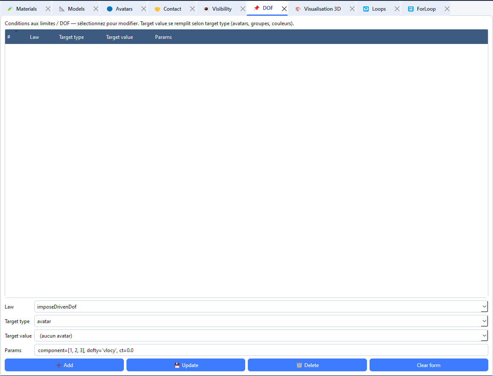

# Conditions aux limites et opérations DOF

L'onglet **DOF** enregistre des opérations cinématiques appliquées aux corps ciblés : blocage ou pilotage d'un degré de liberté, valeur initiale, translation ou rotation géométrique. Une opération est définie par une **loi**, une **cible** et une chaîne de **paramètres**.

## Ajouter une opération

1. Créez les avatars concernés. Pour viser plusieurs corps ensemble, créez un groupe dans **Groups**.
2. Ouvrez **Onglets → Ouvrir → DOF** (`Ctrl+9`).
3. Choisissez **Law**.
4. Choisissez **Target type** : `avatar`, `group` ou `color`.
5. Sélectionnez ou saisissez **Target value**. La liste est réapprovisionnée à partir des avatars, groupes et couleurs du projet ; le champ peut aussi être édité.
6. Renseignez **Params** en adaptant les composantes et valeurs à la dimension du projet.
7. Cliquez sur **➕ Add**. L’opération doit apparaître dans la liste.

Colonnes de la liste : `#` (index), `Law`, `Target type`, `Target value`, `Params` (tronqué à 48 caractères).

### Autres boutons
 
| Bouton | Effet |
|---|---|
| **💾 Update** | remplace l'opération sélectionnée (par son index) par le contenu du formulaire |
| **🗑️ Delete** | supprime l'opération sélectionnée |
| **Clear form** | désélectionne et remet la loi par défaut avec ses paramètres types |
 
Cliquer une ligne recharge la loi, la cible et les paramètres dans le formulaire.

## Opérations disponibles

| Law | Rôle | Exemple de paramètres proposés |
|---|---|---|
| `imposeDrivenDof` | Imposer un degré de liberté piloté | `component=[1, 2, 3], dofty='vlocy', ct=0.0` |
| `imposeInitValue` | Définir une valeur initiale | `component=[1, 2, 3], dofty='vlocy', values=[0.0, 0.0, 0.0]` |
| `translate` | Appliquer une translation géométrique | `dx=0.0, dy=0.0, dz=0.0` |
| `rotate` | Appliquer une rotation autour d’un axe | `description='axis', axis=[0, 0, 1], alpha=0.0` |

Ces chaînes sont des exemples de syntaxe affichés par l’interface. Utilisez les composantes qui existent pour le corps et sa dimension ; ne fournissez pas une composante Z dans un cas 2D. Les paramètres sont transmis au type d’opération correspondant, donc respectez les noms attendus (`component`, `dofty`, `ct`, `values`, `dx`, etc.).

## Choisir la cible

- **avatar** : cible un avatar particulier ; choisissez son entrée dans la liste, qui affiche un identifiant abrégé et son type.
- **group** : cible tous les avatars enregistrés sous le nom du groupe.
- **color** : cible les avatars portant ce code couleur. La liste propose les couleurs présentes dans les avatars/populations et quelques codes LMGC90 usuels.

La cible `avatar` utilise l’identifiant stable du corps, et non sa position dans le tableau. Si un avatar a été supprimé puis recréé, sélectionnez le nouvel avatar dans la liste.

## Types de grandeur (`dofty`)
 
| Physique | `dofty` | Signification |
|---|---|---|
| MECAx | `'vlocy'` | vitesse imposée |
| MECAx | `'force'` | force imposée |
| THERx | `'temp'` | température |
| THERx | `'flux'` | flux |
| POROx | `'vlocy'` / `'force'` | vitesse de filtration / pression |
| MULTI | `'prim_'` / `'dual_'` | variable primale / duale |
 
La liste des valeurs n'est pas contrôlée par l'onglet.

## Modifier et supprimer

1. Sélectionnez l’opération dans la liste du haut.
2. Modifiez **Law**, **Target type**, **Target value** ou **Params**.
3. Cliquez sur **Update**.
4. Pour la retirer, sélectionnez sa ligne puis cliquez sur **Delete**.
5. Cliquez sur **Clear form** avant de créer une opération indépendante.

## Vérifier l’effet visuellement

Ouvrez **Visualisation 3D**, cliquez sur **Rafraîchir la scène**, puis activez **DOF** pour voir les indications correspondant aux opérations configurées. Les symboles sont un contrôle visuel ; ils ne remplacent pas une vérification des paramètres de calcul ni du journal de simulation.
