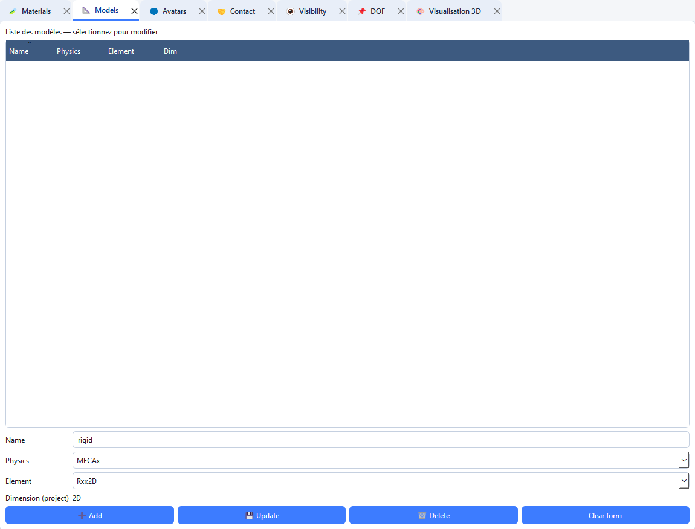

# Créer un modèle

L’onglet **Models** associe une famille physique et un élément fini à une dimension adapté à vos avatars.

## Créer un modèle

1. Ouvrez **Onglets → Ouvrir → Models** (`Ctrl+2`).
2. Saisissez un **Name** de cinq caractères maximum. Une proposition de nom peut apparaître automatiquement.
3. Choisissez **Physics** : `MECAx`, `THERx`, `POROx` ou `MULTI`.
4. Choisissez **Element** dans la liste. Elle est actualisée selon la physique et la dimension du projet.
5. Vérifiez **Dimension (project)**. Cette dimension est héritée du projet ; elle ne se règle pas dans le formulaire du modèle.
6. Cliquez sur **Add**.
7. Vérifiez que le modèle apparaît dans le tableau.

>**Remarque** : Un nom déjà utilisé ne crée pas une deuxième entrée : sélectionnez le modèle existant et choisissez **Update** pour le modifier.

## Modifier ou supprimer

1. Cliquez sur la ligne du modèle dans la liste.
2. Les champs **Name**, **Physics** et **Element** sont rechargés.
3. Modifiez les valeurs puis cliquez sur **Update**.
4. Pour supprimer le modèle sélectionné, cliquez sur **Delete**. Vérifiez auparavant qu’aucun avatar ou configuration ne le référence.
5. Utilisez **Clear form** pour abandonner la sélection et préparer une nouvelle entrée.

## Choisir la physique et l’élément

Les quatre physiques sont toutes implémentées dans LMGC90_GUI Studio.

| Code | Nom complet | Description | Matériaux compatibles |
|------|-------------|-------------|----------------------|
| `MECAx` | Mécanique des solides | Déformation, contrainte, dynamique. | `RIGID`, `ELAS`, `ELAS_DILA`, `VISCO_ELAS`, `ELAS_PLAS` |
| `THERx` | Thermique | Diffusion de chaleur, convection, rayonnement. | `THERMO_ELAS` |
| `POROx` | Poromécanique | Couplage solide / fluide selon la théorie de Biot. | `PORO_ELAS` |
| `MULTI` | Thermo-hydraulique-mécanique (THM) | Couplage complet mécanique + thermique + hydraulique. | `PORO_ELAS`, `THERMO_ELAS` |

>**Remarque** : La liste déroulante est la référence pour les choix disponibles avec la version installée ; elle se met à jour lorsque vous changez la physique.

## Modèle rigide : exemples

### Corps rigide 2D

1. Assurez-vous que le projet est en 2D.
2. Dans **Models**, saisissez par exemple `rigid`.
3. Choisissez `MECAx`.
4. Choisissez `Rxx2D`.
5. Cliquez sur **Add**.

### Corps rigide 3D

1. Créez ou utilisez un projet 3D.
2. Saisissez un nom court, par exemple `rig3D`.
3. Choisissez `MECAx`, puis `Rxx3D`.
4. Cliquez sur **Add**.

## Modèle d’éléments finis

1. Créez un projet de la dimension souhaitée.
2. Dans **Models**, choisissez une physique compatible avec l’analyse envisagée.
3. Sélectionnez l’élément proposé correspondant au type de maillage qui sera construit ou importé.
4. Cliquez sur **Add**.
5. Associez ce modèle à un matériau adapté dans **Materials**, puis choisissez-le lors de la création du corps dans **Avatars** ou dans l’assistant **Deformable**.

>**Remarque** : L’assistant de corps déformable possède des options supplémentaires propres à son parcours de maillage. Elles ne sont pas des champs de l’onglet **Models** : voir [Assistant de corps déformable](meshed.md).

## Éléments disponibles par physique
 
### MECAx — Éléments mécaniques 2D
 
| Élément | Géométrie | Nœuds | Ordre | Description |
|---------|-----------|-------|-------|-------------|
| `Rxx2D` | Point | 1 | — | Corps rigide 2D. Aucune option. |
| `T3xxx` | Triangle 3 nœuds | 3 | 1 | Triangle linéaire standard. |
| `T3Lxx` | Triangle 3 nœuds | 3 | 1 | Triangle linéaire enrichi (incompatible). |
| `T33xx` | Triangle 3 nœuds | 3 | 1 | Triangle mixte déplacement-pression. |
| `T6xxx` | Triangle 6 nœuds | 6 | 2 | Triangle quadratique. |
| `T63xx` | Triangle 6 nœuds | 6 | 2 | Triangle mixte déplacement-pression. |
| `DKTxx` | Triangle 3 nœuds | 3 | 1 | Triangle de Kirchhoff discret (plaques minces). |
| `Q4xxx` | Quadrangle 4 nœuds | 4 | 1 | Quadrangle bilinéaire standard. |
| `Q4P0x` | Quadrangle 4 nœuds | 4 | 1 | Quadrangle bilinéaire + pression constante (quasi-incompressible). |
| `Q44xx` | Quadrangle 4 nœuds | 4 | 1 | Quadrangle mixte déplacement-pression. |
| `Q8xxx` | Quadrangle 8 nœuds | 8 | 2 | Quadrangle sérendipité. |
| `Q8Rxx` | Quadrangle 8 nœuds | 8 | 2 | Quadrangle sérendipité à intégration réduite. |
| `Q84xx` | Quadrangle 8 nœuds | 8 | 2 | Quadrangle mixte déplacement-pression. |
| `Q9xxx` | Quadrangle 9 nœuds | 9 | 2 | Quadrangle Lagrange biquadratique. |
| `BARxx` | Segment 2 nœuds | 2 | 1 | Barre / treillis 1D. |
| `SPRG2` | Segment 2 nœuds | 2 | 1 | Ressort 2D (`discrete=yes__` ajouté automatiquement). |
| `S2xth` | Segment 2 nœuds | 2 | 1 | Élément thermique 1D aussi disponible dans cette famille. |
 
### MECAx — Éléments mécaniques 3D
 
| Élément | Géométrie | Nœuds | Ordre | Description |
|---------|-----------|-------|-------|-------------|
| `Rxx3D` | Point | 1 | — | Corps rigide 3D. Aucune option. |
| `TE4xx` | Tétraèdre 4 nœuds | 4 | 1 | Tétraèdre linéaire. |
| `TE4Lx` | Tétraèdre 4 nœuds | 4 | 1 | Tétraèdre linéaire enrichi (F-bar). |
| `TE44x` | Tétraèdre 4 nœuds | 4 | 1 | Tétraèdre mixte déplacement-pression. |
| `TE10x` | Tétraèdre 10 nœuds | 10 | 2 | Tétraèdre quadratique. |
| `TE104` | Tétraèdre 10 nœuds | 10 | 2 | Tétraèdre mixte déplacement-pression. |
| `H8xxx` | Hexaèdre 8 nœuds | 8 | 1 | Hexaèdre trilinéaire. |
| `H88xx` | Hexaèdre 8 nœuds | 8 | 1 | Hexaèdre mixte déplacement-pression. |
| `H20xx` | Hexaèdre 20 nœuds | 20 | 2 | Hexaèdre sérendipité. |
| `H20Rx` | Hexaèdre 20 nœuds | 20 | 2 | Hexaèdre sérendipité à intégration réduite. |
| `H208x` | Hexaèdre 20 nœuds | 20 | 2 | Hexaèdre mixte déplacement-pression. |
| `PRI6x` | Prisme 6 nœuds | 6 | 1 | Prisme linéaire. |
| `SHB6x` | Prisme 6 nœuds | 6 | 1 | Prisme solide-coque SHB6. |
| `PRI15` | Prisme 15 nœuds | 15 | 2 | Prisme quadratique. |
| `BARxx` | Segment 2 nœuds | 2 | 1 | Barre / treillis 1D. |
| `SPRG3` | Segment 2 nœuds | 2 | 1 | Ressort 3D (`discrete=yes__` ajouté automatiquement). |

>**Remarque** : Si vous devez changer la dimension du projet, passez par **Project → Set dimension…** et examinez l’avertissement avant de confirmer. Le changement ne convertit pas automatiquement les modèles ou avatars existants.
 
### THERx — Éléments thermiques 2D
 
| Élément | Nœuds | Ordre | Options thermiques spécifiques |
|---------|-------|-------|-------------------------------|
| `Rxx2D` | 1 | — | aucune |
| `T3xxx` | 3 | 1 | `capacity_storage`, `formulation`, `convection_type` |
| `T6xxx` | 6 | 2 | `capacity_storage`, `formulation`, `convection_type` |
| `DKTxx` | 3 | 1 | `capacity_storage`, `formulation`, `convection_type` |
| `Q4xxx` | 4 | 1 | `capacity_storage`, `formulation`, `convection_type` |
| `Q4P0x` | 4 | 1 | `capacity_storage`, `formulation`, `convection_type` |
| `Q8xxx` | 8 | 2 | `capacity_storage`, `formulation`, `convection_type` |
| `Q8Rxx` | 8 | 2 | `capacity_storage`, `formulation`, `convection_type` |
| `SPRG2` | 2 | 1 | `capacity_storage` uniquement |
| `S2xth` | 2 | 1 | `capacity_storage`, `formulation`, `convection_type` |
 
### THERx — Éléments thermiques 3D
 
| Élément | Nœuds | Ordre | Options thermiques spécifiques |
|---------|-------|-------|-------------------------------|
| `Rxx3D` | 1 | — | aucune |
| `TE4xx` | 4 | 1 | `capacity_storage`, `formulation`, `convection_type` |
| `TE10x` | 10 | 2 | `capacity_storage`, `formulation`, `convection_type` |
| `H8xxx` | 8 | 1 | `capacity_storage`, `formulation`, `convection_type` |
| `H20xx` | 20 | 2 | `capacity_storage`, `formulation`, `convection_type` |
| `H20Rx` | 20 | 2 | `capacity_storage`, `formulation`, `convection_type` |
| `PRI6x` | 6 | 1 | `capacity_storage`, `formulation`, `convection_type` |
| `PRI15` | 15 | 2 | `capacity_storage`, `formulation`, `convection_type` |
| `SPRG3` | 2 | 1 | `capacity_storage` uniquement |
 
### POROx — Éléments poromécaniques (éléments mixtes déplacement-pression)
 
| Élément | Dim. | Géométrie | Nœuds | Ordre | Description |
|---------|------|-----------|-------|-------|-------------|
| `T33xx` | 2D | Triangle | 3 | 1 | Triangle mixte P1/P1. |
| `T63xx` | 2D | Triangle | 6 | 2 | Triangle mixte P2/P1 — satisfait la condition LBB. |
| `Q44xx` | 2D | Quadrangle | 4 | 1 | Quadrangle mixte Q1/Q1. |
| `Q84xx` | 2D | Quadrangle | 8 | 2 | Quadrangle mixte Q2/Q1 — satisfait la condition LBB. |
| `TE44x` | 3D | Tétraèdre | 4 | 1 | Tétraèdre mixte P1/P1. |
| `TE104` | 3D | Tétraèdre | 10 | 2 | Tétraèdre mixte P2/P1 — satisfait la condition LBB. |
| `H88xx` | 3D | Hexaèdre | 8 | 1 | Hexaèdre mixte Q1/Q1. |
| `H208x` | 3D | Hexaèdre | 20 | 2 | Hexaèdre mixte Q2/Q1 — satisfait la condition LBB. |
 
### MULTI — Éléments THM 2D et 3D
 
Mêmes éléments mixtes que POROx, avec en plus `H8xxx` en 3D pour l'interpolation uniforme des trois champs couplés.
 
| Élément | Dim. | Description |
|---------|------|-------------|
| `T33xx` | 2D | Triangle mixte P1/P1. |
| `T63xx` | 2D | Triangle mixte P2/P1. |
| `Q44xx` | 2D | Quadrangle mixte Q1/Q1. |
| `Q84xx` | 2D | Quadrangle mixte Q2/Q1. |
| `TE44x` | 3D | Tétraèdre mixte P1/P1. |
| `TE104` | 3D | Tétraèdre mixte P2/P1. |
| `H8xxx` | 3D | Hexaèdre trilinéaire (interpolation uniforme THM). |
| `H88xx` | 3D | Hexaèdre mixte Q1/Q1. |
| `H208x` | 3D | Hexaèdre mixte Q2/Q1. |

## Paramètres de modèle disponibles

L’onglet affiche les options associées à la physique et à l’élément choisis. Les éléments rigides `Rxx2D` et `Rxx3D` n’ont pas d’option spécifique. Les ressorts `SPRG2` et `SPRG3` reçoivent automatiquement `discrete="yes__"`. Les options supplémentaires peuvent être saisies au format `nom=valeur`.

### MECAx

| Option | Valeurs proposées |
|--------|-------------------|
| `kinematic` | `small`, `large` |
| `formulation` | `UpdtL`, `TotaL` |
| `mass_storage` | `lump_`, `coher` |
| `material` | `elas_`, `elasd`, `J2iso`, `J2mix`, `kvisc` |
| `anisotropy` | `iso__`, `ortho` |
| `external_model` | `MatL_`, `Demfi`, `Umat_`, `no___`, `yes__` |

Les trois premières options dépendent de l’élément; les trois dernières sont les options communes aux éléments déformables.

### THERx

Les éléments thermiques déformables proposent `capacity_storage` (`coher`), `formulation` (`class`) et `convection_type` (`supg_`, `char_`, `center`). `SPRG2` et `SPRG3` ne proposent que `capacity_storage`. `external_model` est commun (`no___`, `yes__`). Les éléments rigides n’ont pas d’option.

### POROx

Les éléments poromécaniques proposent `kinematic` (`small`, `large`), `mass_storage` et `capacity_storage` (`lump_`, `coher`), ainsi que les options communes `material`, `anisotropy`, `external_model`, `physical_type` (`fluid`, `solid`) et `convection_type` (`supg_`, `char_`, `center`).

### MULTI

Les éléments THM proposent `kinematic`, `mass_storage` et `formulation`, avec les options communes `material`, `anisotropy`, `external_model`, `fluid_comp_storage` (`lump_`, `coher`) et `convection_type` (`supg_`, `char_`, `center`).

---
 
## Tableau récapitulatif par usage
 
| Usage | Dimension | Éléments recommandés | Remarque |
|-------|-----------|---------------------|----------|
| Corps rigides 2D (DEM) | 2D | `Rxx2D` | Aucune option |
| Corps rigides 3D (DEM) | 3D | `Rxx3D` | Aucune option |
| Ressorts / barres 2D | 2D | `SPRG2`, `BARxx` | `discrete=yes__` auto |
| Ressorts / barres 3D | 3D | `SPRG3`, `BARxx` | `discrete=yes__` auto |
| Structures 2D — précision standard | 2D | `Q4xxx`, `T3xxx` | Rapide, adapté aux maillages structurés |
| Structures 2D — géométrie complexe | 2D | `T6xxx`, `Q8xxx` | Maillages automatiques non structurés |
| Plaques minces 2D | 2D | `DKTxx` | Formulation Kirchhoff |
| Quasi-incompressibilité 2D | 2D | `Q4P0x` | Pression constante par élément |
| Structures 3D — maillage structuré | 3D | `H8xxx`, `H20xx` | Hexaèdres recommandés |
| Structures 3D — maillage automatique | 3D | `TE10x`, `TE4xx` | Tétraèdres adaptatifs |
| Coques épaisses 3D | 3D | `SHB6x`, `PRI6x` | Solidescoques |
| Thermique 2D | 2D | `Q4xxx`, `T3xxx` | Physique THERx |
| Thermique 3D | 3D | `H8xxx`, `TE4xx` | Physique THERx |
| Segment thermique 1D | 2D / 3D | `S2xth` | Physique THERx uniquement |
| Poro-mécanique 2D (Biot) | 2D | `T63xx`, `Q84xx` | LBB satisfaite — recommandé |
| Poro-mécanique 3D (Biot) | 3D | `TE104`, `H208x` | LBB satisfaite — recommandé |
| THM couplé 3D | 3D | `H8xxx`, `TE104` | Physique MULTI |

---

## Tableau de compatibilité matériau / physique
 
| Matériau | MECAx | THERx | POROx | MULTI |
|----------|-------|-------|-------|-------|
| `RIGID` | ✅ | ❌ | ❌ | ❌ |
| `ELAS` | ✅ | ✅ | ❌ | ❌ |
| `ELAS_DILA` | ✅ | ✅ | ❌ | ❌ |
| `VISCO_ELAS` | ✅ | ❌ | ❌ | ❌ |
| `ELAS_PLAS` | ✅ | ❌ | ❌ | ❌ |
| `THERMO_ELAS` | ✅ | ✅ | ❌ | ✅ |
| `PORO_ELAS` | ❌ | ❌ | ✅ | ✅ |
| `DISCRETE` | ✅ | ❌ | ❌ | ❌ |
| `USER_MAT` | ✅ | ❌ | ❌ | ❌ |
| `EXTERNAL` | ✅ | ❌ | ❌ | ❌ |
 
---
 
## Tableau de compatibilité matériau / option material
 
| `Matériau` | `elas_` | `elasd` | `J2iso` | `J2mix` | `kvisc` |
|----------|---------|---------|---------|---------|---------|
| `RIGID` | ✅ | — | — | — | — |
| `ELAS` | ✅ | — | — | — | — |
| `ELAS_DILA` | ✅ | ✅ | — | — | — |
| `VISCO_ELAS` | — | — | — | — | ✅ |
| `ELAS_PLAS` | — | ✅ | ✅ | ✅ | — |
| `THERMO_ELAS` | ✅ | ✅ | — | — | — |
